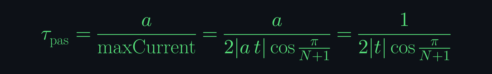
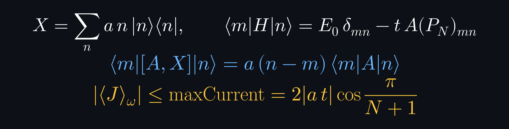
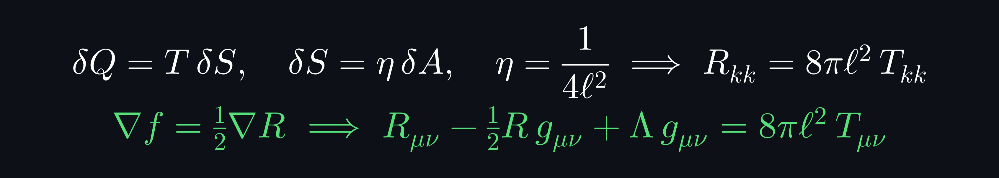

<div align="center">

# Le temps compte les pas
### Sur la chaîne de tight binding de Physlib, l'espacement `a` se simplifie : un pas dure `1 / (2|t| cos(π/(N+1)))`, `n` pas durent `n` fois plus, et sans pas il n'y a pas de temps

**Eduardo Nava Hernández · José Arturo Nava Hernández**  
*Dépôt 30 · vérification formelle en Lean 4 · 0 sorry · sur Physlib*

[](https://leanprover.github.io/)
[](https://github.com/leanprover-community/physlib/pull/2096)
[](Verification/Axioms.lean)

</div>

---

> ### Ce que distingue le théorème
>
> Le modèle commence là où il y a de la masse ; ce qui restait à fixer, c'est le temps. Sur la
> chaîne ouverte, la position est `X = Σ a n |n⟩⟨n|` et le hamiltonien est le saut du graphe
> chemin, `H = E₀ I − t A(P_N)` (Physlib #2096). L'espacement `a` n'entre que par `X`, donc le
> courant porte un facteur `a` et aucun état ne dépasse `maxCurrent = 2|a t| cos(π/(N+1))`. Un pas,
> un espacement à la vitesse limite, dure donc un temps où `a` se simplifie.
>
> <div align="center">
> 
> </div>
>
> 1. **`a` se simplifie** : `a / maxCurrent = 1 / (2|t| cos(π/(N+1)))`, le même pour tout espacement.
> 2. **Le temps compte les pas** : `n` pas durent `n · τ_pas` ; aucun état ne parcourt `n` espacements plus vite ; l'état de courant maximal les parcourt exactement en ce temps.
> 3. **Sans pas, pas de temps** : `n · τ_pas = 0 ⟺ n = 0`.
> 4. **Lumière ou masse** : l'état de courant maximal sature Robertson–Schrödinger exactement en `N = 2, 3` ; dès `N = 4` son rapport d'incertitude vérifie `1 < C < √(π²/3 − 2)`.
> 5. **Einstein** : l'horloge accélérée fixe la température `α/2π` (accélération `α`), et la relation de Clausius sur chaque nappe de lumière, avec `η = 1/(4ℓ²)`, donne `Ric − ½ R g + Λ g = 8π ℓ² T`.

<div align="center">

</div>

---

## Résumé formel

**Le pas.** `stepTime T = a / maxCurrent`, et `stepTime_eq` : il vaut `1 / (2|t| cos(π/(N+1)))`.
Deux chaînes de même `N` et même `t` ont le même pas, quel que soit leur espacement
(`stepTime_eq_of_eq`) ; il est strictement positif pour `t ≠ 0`, `N ≥ 2` (`stepTime_pos`).

**Le temps de `n` pas.** `elapsed T n = n · stepTime T`. Il est nul exactement quand `n = 0`
(`elapsed_eq_zero_iff`). Pour tout état de courant non nul, parcourir `n` espacements prend au
moins `elapsed T n` (`elapsed_le_travelTime`), et l'état de courant maximal le fait exactement
en ce temps (`elapsed_eq_travelTime_maxCurrentState`).

**Lumière ou masse.** Le défaut de Gram de l'état de courant maximal est nul exactement en
`N = 2, 3`, et dès `N = 4` le rapport d'incertitude est strictement entre `1` et `√(π²/3 − 2)`.
Avec ce qui précède : `timeCountsSteps`.

**Horloge accélérée et Einstein.** La ligne d'univers de Rindler d'accélération `α` est paramétrée
par le temps propre, de période imaginaire minimale `2π/α` et de température `α/2π`
(`acceleratedClock`). Clausius sur chaque nappe de lumière avec `η = 1/(4ℓ²)`, et `∇f = ½ ∇R`,
donnent l'équation d'Einstein de couplage `8π ℓ²` (`einstein_eightPi`).

**Clôture.** `properTime_generalRelativity`.

---

## Les étapes

### Étape 1 : l'espacement n'entre que par la position

> **Proposition 1.1 (Physlib).** `X = Σ a n |n⟩⟨n|`, `⟨m|H|n⟩ = E₀ δ_mn − t A(P_N)_mn`,
> `⟨m|[A, X]|n⟩ = a (n − m) ⟨m|A|n⟩`, et `|⟨J⟩_ω| ≤ maxCurrent = 2|a t| cos(π/(N+1))` pour tout état `ω`.

<div align="center">

</div>

*Modules formels :* Physlib `PhyslibAlpha/CondensedMatter/TightBindingChain` : `Open/Basic.lean` (#2096) et `Current/SpeedLimit.lean`.

### Étape 2 : `a` se simplifie, le temps compte les pas

> **Théorème 2.1.** `τ_pas = a / maxCurrent = 1 / (2|t| cos(π/(N+1)))` ; `t_n = n τ_pas` ;
> `t_n ≤ n a / |⟨J⟩_ω|` pour tout état de courant non nul ; égalité pour l'état de courant maximal ; `t_n = 0 ⟺ n = 0`.

<div align="center">

</div>

*Modules formels :* [`StepTime.lean`](src/ProperTimeGeneralRelativity/StepTime.lean) (`stepTime_eq`, `stepTime_eq_of_eq`, `stepTime_pos`, `elapsed_eq_zero_iff`, `elapsed_le_travelTime`, `elapsed_eq_travelTime_maxCurrentState`).  
`|a t| = a |t|` car `a > 0`, puis `a / (a · b) = 1 / b`.

### Étape 3 : lumière en `N = 2, 3`, masse dès `N = 4`

> **Proposition 3.1 (Physlib).** L'état de courant maximal sature Robertson–Schrödinger exactement
> en `N = 2, 3` ; dès `N = 4`, `1 < C < √(π²/3 − 2)`.

<div align="center">

</div>

*Modules formels :* Physlib `MaxCurrentState/Saturation.lean`, `UncertaintyRatio.lean`, `LongChainMonotonicity.lean` (#1735) ; réunis dans [`StepTime.lean`](src/ProperTimeGeneralRelativity/StepTime.lean) (`timeCountsSteps`).

### Étape 4 : l'horloge accélérée

> **Proposition 4.1.** La ligne d'univers d'accélération `α > 0` vérifie `ṫ² − ẋ² = 1`,
> `ẍ² − ẗ² = α²`, a pour plus courte période imaginaire `2π/α`, et `T · 2π/α = 1`.

<div align="center">

</div>

*Modules formels :* [`Unruh.lean`](src/ProperTimeGeneralRelativity/Gravity/Unruh.lean) (`velocity_norm`, `acceleration_norm`, `periodic_two_pi`, `period_ge`, `unruhTemperature_mul_period`) ;
[`ProperTimeGeneralRelativity.lean`](src/ProperTimeGeneralRelativity.lean) (`acceleratedClock`).  
Dans le code Lean l'accélération s'appelle `a` (`Rindler.time a`), sans lien avec l'espacement de la chaîne.

### Étape 5 : Clausius sur chaque nappe de lumière donne Einstein

> **Théorème 5.1.** Avec `η = 1/(4ℓ²)`, si `δQ = T δS` vaut sur chaque nappe de lumière par chaque
> point et si `∇f = ½ ∇R`, il existe `Λ` constante avec `Ric − ½ R g + Λ g = 8π ℓ² T`.

<div align="center">

</div>

*Modules formels :* [`Clausius.lean`](src/ProperTimeGeneralRelativity/Gravity/Clausius.lean) (`clausius_iff`, `eight_pi`) ;
[`EinsteinEquation.lean`](src/ProperTimeGeneralRelativity/Gravity/EinsteinEquation.lean) (`einstein_equation`) ;
[`ProperTimeGeneralRelativity.lean`](src/ProperTimeGeneralRelativity.lean) (`einstein_eightPi`, `properTime_generalRelativity`).  
`Ric − κ T` s'annule sur le cône de lumière, donc c'est `f g` ; la trace donne `R`, et `R/2 − f` est constante.

---

## Physlib : pull requests fusionnées

| PR | Énoncé | Étape |
|---|---|---|
| [#2096](https://github.com/leanprover-community/physlib/pull/2096) | la chaîne ouverte est le saut du graphe chemin : `H = E₀ I − t A(P_N)` | 1 |
| [#1734](https://github.com/leanprover-community/physlib/pull/1734) | `C → √(π²/3 − 2)` pour les longues chaînes | 3 |
| [#1735](https://github.com/leanprover-community/physlib/pull/1735) | `C` strictement croissant dès quatre sites, `C < √(π²/3 − 2)` | 3 |

---

## Catalogue des modules Lean

| Module | Déclaration | Signification | Statut |
|---|---|---|---|
| [`StepTime.lean`](src/ProperTimeGeneralRelativity/StepTime.lean) | `stepTime_eq` | `a / maxCurrent = 1 / (2|t| cos(π/(N+1)))` | 0 sorry |
| [`StepTime.lean`](src/ProperTimeGeneralRelativity/StepTime.lean) | `elapsed_eq_zero_iff` | sans pas, pas de temps | 0 sorry |
| [`StepTime.lean`](src/ProperTimeGeneralRelativity/StepTime.lean) | `elapsed_le_travelTime` | aucun état plus rapide que les pas | 0 sorry |
| [`StepTime.lean`](src/ProperTimeGeneralRelativity/StepTime.lean) | `timeCountsSteps` | le temps compte les pas ; lumière ou masse | 0 sorry |
| [`ProperTimeGeneralRelativity.lean`](src/ProperTimeGeneralRelativity.lean) | `acceleratedClock` | temps propre, période `2π/α`, `T = α/2π` | 0 sorry |
| [`EinsteinEquation.lean`](src/ProperTimeGeneralRelativity/Gravity/EinsteinEquation.lean) | `einstein_equation` | Clausius partout donne Einstein | 0 sorry |
| [`ProperTimeGeneralRelativity.lean`](src/ProperTimeGeneralRelativity.lean) | `einstein_eightPi` | Einstein avec couplage `8π ℓ²` | 0 sorry |
| [`ProperTimeGeneralRelativity.lean`](src/ProperTimeGeneralRelativity.lean) | `properTime_generalRelativity` | les étapes réunies | 0 sorry |

`Unruh.lean`, `Clausius.lean`, `NullForms.lean` et `EinsteinEquation.lean` viennent de
[`nrs3-tritoro`](https://github.com/naype888-cloud/nrs3-tritoro) (`NRS3Tritoro/Gravity`), copiés
sans modification sauf le chemin des imports.

---

## Compilation et certification du noyau

Lean 4 `v4.35.0`. Seule dépendance : Physlib, au commit de fusion de #2096.

```bash
lake exe cache get
lake build
lake env lean Verification/Axioms.lean
# 'ProperTimeGR.properTime_generalRelativity' depends on axioms: [propext, Classical.choice, Quot.sound]
```

0 sorry, aucun axiome ad hoc, `autoImplicit = false`.

---

## Chronologie

| Année | Événement | Dépôt associé |
|---|---|---|
| 1915 | Einstein : les équations du champ | **ce dépôt** |
| **1929–30** | **Robertson et Schrödinger : l'inégalité d'incertitude** | [dépôt de base](https://github.com/naype888-cloud/nava-robertson-schrodinger) |
| 1976 | Unruh : la température de l'observateur accéléré | **ce dépôt** |
| 1995 | Jacobson : l'équation d'Einstein depuis la relation de Clausius | **ce dépôt** · [`nrs3-tritoro`](https://github.com/naype888-cloud/nrs3-tritoro) |

---

## La mosaïque des dépôts RS^N³

- [RS^N et RS^N³ — Le théorème de base](https://github.com/naype888-cloud/nava-robertson-schrodinger)
- [RS^N³ · Tritoro](https://github.com/naype888-cloud/nrs3-tritoro)
- [RS^N³ · Mandelstam–Tamm et Cramér–Rao](https://github.com/naype888-cloud/nrs3-mandelstam-tamm-cramer-rao)
- [RS^N³ · Bekenstein — Bits on the Boundary](https://github.com/naype888-cloud/nrs3-bekenstein)
- [La chaîne close](https://github.com/naype888-cloud/Anti-Kurt-Godel-Theorem)
- **[Le temps compte les pas](https://github.com/naype888-cloud/Proper-Time-General-Relativity)** (ce dépôt)

---

<div align="center">

*L'espacement se simplifie ; il reste les pas, et sans pas il n'y a pas de temps.*

</div>

## Licence

NRS Noncommercial License 1.0.0, voir [`LICENSE`](LICENSE).
