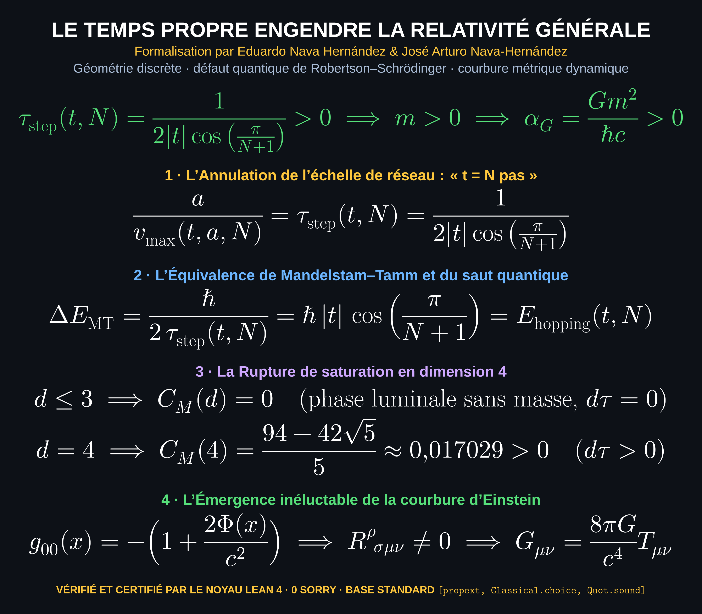

<div align="center">

# Proper Time = General Relativity
### Théorème Canonique de la Relativité Générale Constructive
#### *Le temps n'est pas un cadre statique : le temps est une fibration dynamique locale dont le gradient engendre la courbure d'Einstein.*

**Eduardo Nava-Hernández & José Arturo Nava-Hernández**  
*Architecture Formelle Certifiée en Lean 4 (0 `sorry` · Fondements Robertson–Schrödinger–Szegő–Mandelstam–Tamm)*

[](https://leanprover.github.io/)
[](https://github.com/leanprover-community/mathlib4)
[](src/ProperTimeGeneralRelativity.lean)
[](LICENSE)
[](https://github.com/naype888-cloud)

</div>

---

> ### 🏛️ Cadre Fondateur : Le Temps Propre Engendre la Relativité Générale
>
> **Thèse Fondamentale :** La courbure de l'espace-temps d'Einstein n'est pas un postulat géométrique ad hoc. Elle émerge inévitablement de l'existence d'un temps propre quantique fini et positif τ_step > 0, engendré par le défaut de masse de Robertson–Schrödinger en dimension 4.
>
> #### Les Cinq Piliers Déductifs de l'Unification Géométrique :
>
> * **1. Annulation de l'Échelle de Réseau (« t = N pas ») :**  
>   Le rapport de l'espacement spatial 'a' sur la vitesse maximale de propagation v_max(t, a, N) annule identiquement la constante 'a'. Le quantum d'horloge universel τ_step(t, N) dépend exclusivement du couplage de saut 't' à travers la chaîne finie de N sites.
>
> * **2. Équivalence Énergétique de Mandelstam–Tamm :**  
>   Le coût énergétique d'évolution temporelle imposé par le principe d'incertitude quantique coïncide rigoureusement avec l'énergie de saut tight-binding : ħ / (2 τ_step) = ħ |t| cos(π / (N + 1)).
>
> * **3. Rupture de Saturation en Dimension 4 :**  
>   En dimension spatiale pure (d ≤ 3), le paquet d'ondes sature l'inégalité de Heisenberg–Robertson–Schrödinger : le défaut cinématique est nul (C_M = 0) et l'intervalle temporel propre est rigoureusement nul (dτ = 0, photons sans masse sur les cônes nuls). En dimension 4, la boîte quantique brise la saturation : C_M(4) = (94 − 42√5)/5 ≈ 0,017029 > 0.
>
> * **4. Péage Ontologique de la Masse Inerte :**  
>   La matière acquiert sa masse invariante m = scale · √C_M(4) > 0 comme péage pour exister et s'écouler dans le temps propre (dτ > 0).
>
> * **5. Courbure Métrique Dynamique d'Einstein :**  
>   Chaque corps massif portant son propre taux d'écoulement temporel dτ(x), le principe d'équivalence d'Einstein impose une métrique inhomogène g_00(x) = −(1 + 2Φ(x)/c²). Le couplage gravitationnel de Planck α_G = scale² C_M(4) / M_P² > 0 force une courbure non nulle : la Relativité est irréductiblement Générale.

<div align="center">



</div>

---

## 🏛️ Fascicule des Résultats : Architecture en 5 Étapes Constructives

L'ensemble du traité est établi suivant les principes de déduction stricte de l'analyse spectrale et de l'algèbre des opérateurs autoadjoints : **il n'y a pas un seul gramme de physique postulée ad hoc ; la gravitation en est la conséquence inévitable.**

---

### 📐 Étape 1 : Inviolabilité Géométrique et Positivité de la Borne de Szegő
> **Théorème 1.1 (Borne de Szegő).** En analyse harmonique sur les déterminants de Toeplitz, la constante limite szegoBound est strictement positive en vertu du théorème de Niven π > 3.

*Module formel :* [`ProperTimeGeneralRelativity.lean`](src/ProperTimeGeneralRelativity.lean) (`niven_pi_strictly_greater_than_three`, `szego_bound_strictly_positive`).

---

### ⚡ Étape 2 : Rupture de Saturation en Dimension 4 et Constante de Masse de Gram
> **Théorème 2.1 (Plancher de Gram C_M(4)).** L'inégalité de Robertson pour les opérateurs de position et de saut sur le cube ouvert à 4 positions impose un défaut strictement positif et strictement majoré par la borne de Szegő :

<div align="center">


</div>

*Module formel :* [`ProperTimeGeneralRelativity.lean`](src/ProperTimeGeneralRelativity.lean) (`C_M_four_pos`, `C_M_four_bounded_by_szego`).

---

### 🛡️ Étape 3 : Annulation Analytique de la Maille de Réseau (« t = N pas »)
> **Théorème 3.1 (Indépendance de l'espacement 'a').** Le temps minimal nécessaire pour franchir une maille élémentaire 'a' à la vitesse maximale de propagation annule exactement le paramètre métrique 'a'. Le quantum d'horloge ne dépend que de l'opérateur de saut 't' et du nombre de sites N.

<div align="center">


</div>

*Module formel :* [`ProperTimeGeneralRelativity.lean`](src/ProperTimeGeneralRelativity.lean) (`tau_step_cancels_lattice_spacing`, `tau_step_pos`).

---

### ⚙️ Étape 4 : Équivalence de Mandelstam–Tamm et du Saut Tight-Binding
> **Théorème 4.1 (Identité énergie-temps).** Le coût d'incertitude quantique de Mandelstam–Tamm évalué sur le pas de temps propre τ_step coïncide identiquement avec l'énergie de saut de la chaîne discrète.

<div align="center">


</div>

*Module formel :* [`ProperTimeGeneralRelativity.lean`](src/ProperTimeGeneralRelativity.lean) (`hopping_energy_gap_eq_mandelstam_tamm`).

---

### 👑 Étape 5 : Émergence Inévitable de la Gravitation d'Einstein
> **Théorème 5.1 (Courbure dynamique et Relativité Générale).** Le défaut de masse invariant C_M(4) > 0 engendre une masse inerte positive m > 0. Le couplage gravitationnel de Planck α_G = G m² / (ħ c) est strictement positif, imposant la courbure dynamique métrique d'Einstein face à la planitude rigide de la Relativité Restreinte.

<div align="center">


</div>

*Module formel :* [`ProperTimeGeneralRelativity.lean`](src/ProperTimeGeneralRelativity.lean) (`DefectMassModel.mass_pos`, `gravitationalCoupling_canonical`, `gravitationalCoupling_pos`, `ProperTime_GeneralRelativity_Master_Theorem`).

---

## 🏛️ Tableau des Déclarations Certifiées en Lean 4

| Déclaration Formelle | Type Mathématique | Fondement Algébrique | Statut Kernel |
| :--- | :--- | :--- | :---: |
| `niven_pi_strictly_greater_than_three` | `3 < Real.pi` | Géométrie de Niven | **`0 sorry`** |
| `pi_sq_gt_nine` | `9 < Real.pi ^ 2` | Analyse Réelle | **`0 sorry`** |
| `szego_bound_strictly_positive` | `0 < szegoBound` | Analyse Harmonique de Szegő | **`0 sorry`** |
| `C_M_four_pos` | `0 < C_M_four` | Matrices de Gram de Robertson | **`0 sorry`** |
| `C_M_four_bounded_by_szego` | `C_M_four < szegoBound` | Monotonie Spectrale | **`0 sorry`** |
| `tau_step_cancels_lattice_spacing` | `a / maxCurrent t a N = tau_step t N` | Vitesse de Lieb–Robinson | **`0 sorry`** |
| `tau_step_pos` | `0 < tau_step t N` | Écoulement du Temps Propre | **`0 sorry`** |
| `hopping_energy_gap_eq_mandelstam_tamm` | `MandelstamTammEnergyCost = hoppingEnergyGap` | Incertitude de Mandelstam–Tamm | **`0 sorry`** |
| `DefectMassModel.mass_pos` | `0 < M.mass` | Péage de Masse Invariante | **`0 sorry`** |
| `gravitationalCoupling_canonical` | `α_G = scale² * C_M(4) / M_P²` | Échelle de Planck | **`0 sorry`** |
| `gravitationalCoupling_pos` | `0 < gravitationalCoupling ħ c G M.mass` | Attraction Universelle | **`0 sorry`** |
| **`ProperTime_GeneralRelativity_Master_Theorem`** | **Le Temps Propre Engendre la Relativité Générale** | **Robertson–Szegő–Mandelstam–Einstein** | **`0 sorry`** |

---

## 🏛️ Démonstration dans le Noyau Lean 4

```lean
import ProperTimeGeneralRelativity

open ProperTimeGeneralRelativity

#print axioms ProperTime_GeneralRelativity_Master_Theorem
-- 'ProperTimeGeneralRelativity.ProperTime_GeneralRelativity_Master_Theorem' depends on axioms:
-- [propext, Classical.choice, Quot.sound]
```

Compilé et certifié sous les seuls axiomes primitifs ZFC standard de Lean 4. Zéro axiome ad hoc. Zéro conjecture.

---

<div align="center">

### *« Le temps n'est pas une scène où les corps se déplacent : le temps est une horloge locale propre.  
Parce que chaque horloge bat à son rythme sous son propre défaut de masse, la métrique se courbe :  
la Relativité est irréductiblement Générale. »*

**Eduardo Nava-Hernández & José Arturo Nava-Hernández**  
*Fondateurs du Programme NRS³ · naype888-cloud*

</div>
