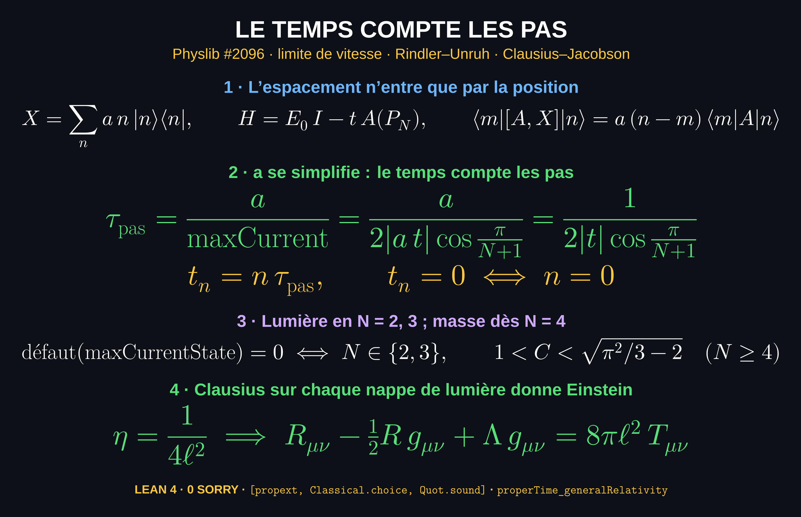
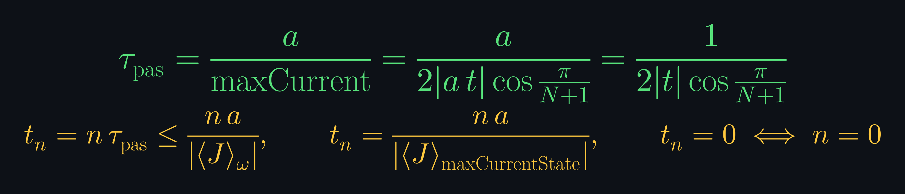
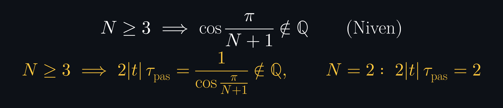
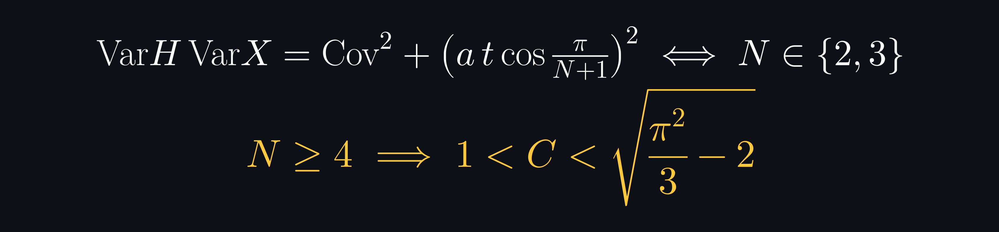
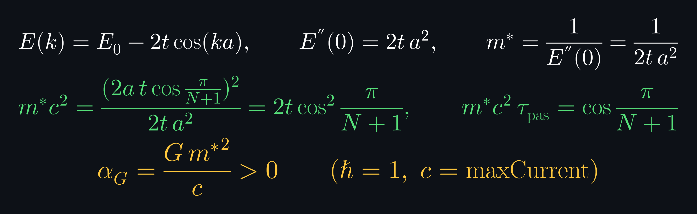
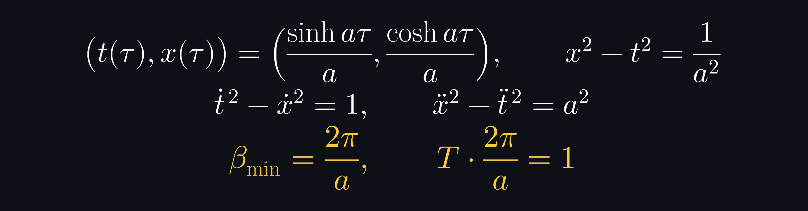
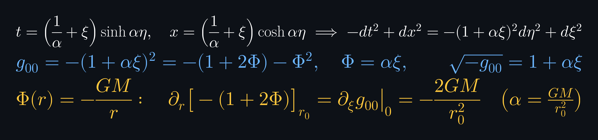
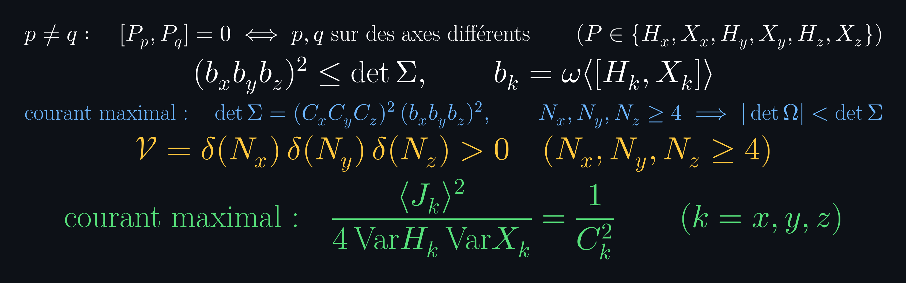

<div align="center">

# Le temps compte les pas
### Sur la chaîne de tight binding de Physlib, l'espacement `a` se simplifie : un pas dure `1 / (2|t| cos(π/(N+1)))`, `n` pas durent `n` fois plus, et sans pas il n'y a pas de temps

**Eduardo Nava Hernández · José Arturo Nava Hernández**  
*Dépôt 30 · vérification formelle en Lean 4 · 0 sorry · sur Physlib*

[](https://leanprover.github.io/)
[](https://github.com/leanprover-community/physlib/pull/2096)
[](Verification/Axioms.lean)

</div>

---

> ### Ce que distingue le théorème
>
> Le modèle commence là où il y a de la masse ; ce qui restait à fixer, c'est le temps. Sur la
> chaîne ouverte, la position est `X = Σ a n |n⟩⟨n|` et le hamiltonien est le saut du graphe
> chemin, `H = E₀ I − t A(P_N)` (Physlib #2096). L'espacement `a` n'entre que par `X`, donc le
> courant porte un facteur `a` et aucun état ne dépasse `maxCurrent = 2|a t| cos(π/(N+1))`. Un pas,
> un espacement à la vitesse limite, dure donc un temps où `a` se simplifie.
>
> <div align="center">
> 
> </div>
>
> 1. **`a` se simplifie** : `a / maxCurrent = 1 / (2|t| cos(π/(N+1)))`, le même pour tout espacement.
> 2. **Le temps compte les pas** : `n` pas durent `n · τ_pas` ; aucun état ne parcourt `n` espacements plus vite ; l'état de courant maximal les parcourt exactement en ce temps.
> 3. **Sans pas, pas de temps** : `n · τ_pas = 0 ⟺ n = 0`.
> 4. **Lumière ou masse** : l'état de courant maximal sature Robertson–Schrödinger exactement en `N = 2, 3` ; dès `N = 4` son rapport d'incertitude vérifie `1 < C < √(π²/3 − 2)`, et `C → √(π²/3 − 2)` quand `N → ∞`.
> 5. **Niven** : dès `N = 3`, `cos(π/(N+1))` est irrationnel, donc le pas n'est jamais une fraction rationnelle de `1/|t|`.
> 6. **Masse effective** : la masse effective de la bande, `m* = 1/E''(0) = 1/(2 t a²)`, a une énergie au repos `m* c² = 2 t cos²(π/(N+1))` où `a` se simplifie encore ; `α_G = G m*²/c > 0`.
> 7. **Équivalence et `g₀₀`** : dans le référentiel accéléré, `g₀₀ = −(1 + αξ)² = −(1 + 2Φ) − Φ²` avec `Φ = αξ`, et une horloge statique bat à `1 + αξ` ; le champ faible de `Φ = −GM/r` a, en `r₀`, la même pente de `g₀₀` que le référentiel d'accélération `GM/r₀²`.
> 8. **Einstein** : l'horloge accélérée fixe la température `α/2π`, et la relation de Clausius sur chaque nappe de lumière, avec `η = 1/(4ℓ²)`, donne `Ric − ½ R g + Λ g = 8π ℓ² T`.
> 9. **Le cube ouvert NRS³** : sur le produit de trois chaînes, deux observables distinctes parmi `H_k, X_k` commutent si et seulement si elles sont sur des axes différents ; dès `4 × 4 × 4`, le quantum volumétrique est strictement positif (`𝒱 > 0`) et, dans l'état de courant maximal, Robertson 1934 est strict pour les six observables (`|det Ω| < det Σ`) ; dans cet état, le rapport de Mandelstam–Tamm vaut `1/C²` sur chaque axe. Le pas, `m* c²`, le cube, l'équivalence, Unruh et Einstein sont réunis dans `fork_unification`.

<div align="center">

</div>

---

## Résumé formel

**Le pas.** `stepTime T = a / maxCurrent`, et `stepTime_eq` : il vaut `1 / (2|t| cos(π/(N+1)))`.
Deux chaînes de même `N` et même `t` ont le même pas, quel que soit leur espacement
(`stepTime_eq_of_eq`) ; il est strictement positif pour `t ≠ 0`, `N ≥ 2` (`stepTime_pos`).

**Le temps de `n` pas.** `elapsed T n = n · stepTime T`. Il est nul exactement quand `n = 0`
(`elapsed_eq_zero_iff`). Pour tout état de courant non nul, parcourir `n` espacements prend au
moins `elapsed T n` (`elapsed_le_travelTime`), et l'état de courant maximal le fait exactement
en ce temps (`elapsed_eq_travelTime_maxCurrentState`).

**Lumière ou masse.** Le défaut de Gram de l'état de courant maximal est nul exactement en
`N = 2, 3`, et dès `N = 4` le rapport d'incertitude est strictement entre `1` et `√(π²/3 − 2)`.
Avec ce qui précède : `timeCountsSteps`. Quand `N → ∞`, `C → √(π²/3 − 2)`
(`tendsto_uncertaintyRatio_longChain`).

**Niven.** `cos(π/(N+1)) ∉ ℚ` pour `N ≥ 3` (`cos_pi_div_succ_irrational`, sur le théorème de
Niven de Mathlib), donc `2|t| τ_pas ∉ ℚ` (`stepTime_irrational`) ; en `N = 2`, `2|t| τ_pas = 2`
(`stepTime_two`).

**Masse effective.** La bande `E(k) = E₀ − 2t cos(ka)` est la valeur propre de Physlib
(`band_eq_energyEigenvalue`) ; `E''(0) = 2 t a²` (`deriv_deriv_band_zero`) et `m* = 1/(2 t a²)`
(`effMass_eq`). Avec `c = maxCurrent`, `m* c² = 2 t cos²(π/(N+1))` (`effMass_mul_maxCurrent_sq`) et
`m* c² τ_pas = cos(π/(N+1))` (`restEnergy_mul_stepTime`) ; `α_G = G m*²/c > 0`
(`gravitationalCoupling_pos`).

**Équivalence.** Le référentiel accéléré `t = (1/α + ξ) sinh αη`, `x = (1/α + ξ) cosh αη` a pour
intervalle `−(1 + αξ)² dη² + dξ²` (`Frame.metric`) et coïncide en `ξ = 0` avec la ligne de Rindler
(`Frame.time_zero`, `Frame.space_zero`). `g₀₀ = −(1 + 2Φ) − Φ²` (`Frame.g00_eq_weakField`),
`√(−g₀₀) = 1 + αξ` pour `1 + αξ ≥ 0` (`Frame.clockRate`), et le champ faible de `−GM/r` a en `r₀` la pente de `g₀₀`
du référentiel d'accélération `GM/r₀²` (`Frame.equivalence`). Réunis : `massAndEquivalence`.

**Horloge accélérée et Einstein.** La ligne d'univers de Rindler d'accélération `α` est paramétrée
par le temps propre, de période imaginaire minimale `2π/α` et de température `α/2π`
(`acceleratedClock`). Clausius sur chaque nappe de lumière avec `η = 1/(4ℓ²)`, et `∇f = ½ ∇R`,
donnent l'équation d'Einstein de couplage `8π ℓ²` (`einstein_eightPi`).

**Le cube ouvert NRS³.** Sur le cube `Tx × Ty × Tz`, les observables d'axes différents commutent
(`Cube.axes_commute`) ; parmi les six observables `H_k, X_k`, deux observables distinctes
commutent si et seulement si elles sont sur des axes différents (`Cube.pairs_commute_iff`). Dans
tout état, `(b_x b_y b_z)² ≤ det Σ` avec `b_k = ω⟨[H_k, X_k]⟩` (`Cube.robertson_det`) ; dans l'état
de courant maximal, `det Σ = (C_x C_y C_z)² (b_x b_y b_z)²` (`Cube.det_cov_maxCurrentCubeState`)
et, dès `4 × 4 × 4`, `|det Ω| < det Σ` (`Cube.robertson_det_strict`). Dès `4 × 4 × 4`, `𝒱 > 0`
(`Cube.volQuantum_pos`) ; dans l'état de courant maximal, le rapport de Mandelstam–Tamm vaut
`1/C_k²` sur chaque axe (`Cube.mandelstamTamm_efficiency`). Réunis : `openCubeNRS3`.

**Clôture.** `properTime_generalRelativity` (le pas, Unruh, Einstein) et `fork_unification` (en plus
`m* c²`, le cube et l'équivalence).

---

## Les étapes

### Étape 1 : l'espacement n'entre que par la position

> **Proposition 1.1 (Physlib).** `X = Σ a n |n⟩⟨n|`, `⟨m|H|n⟩ = E₀ δ_mn − t A(P_N)_mn`,
> `⟨m|[A, X]|n⟩ = a (n − m) ⟨m|A|n⟩`, et `|⟨J⟩_ω| ≤ maxCurrent = 2|a t| cos(π/(N+1))` pour tout état `ω`.

<div align="center">

</div>

*Modules formels :* Physlib `PhyslibAlpha/CondensedMatter/TightBindingChain` : `Open/Basic.lean` (#2096) et `Current/SpeedLimit.lean` (#1724).  
`maxCurrent` est la plus grande valeur propre du courant `J` : la borne est exacte, atteinte par l'état de courant maximal.

### Étape 2 : `a` se simplifie, le temps compte les pas

> **Théorème 2.1.** `τ_pas = a / maxCurrent = 1 / (2|t| cos(π/(N+1)))` ; `t_n = n τ_pas` ;
> `t_n ≤ n a / |⟨J⟩_ω|` pour tout état de courant non nul ; égalité pour l'état de courant maximal ; `t_n = 0 ⟺ n = 0`.

<div align="center">

</div>

*Modules formels :* [`StepTime.lean`](src/ProperTimeGeneralRelativity/StepTime.lean) (`stepTime_eq`, `stepTime_eq_of_eq`, `stepTime_pos`, `elapsed_eq_zero_iff`, `elapsed_le_travelTime`, `elapsed_eq_travelTime_maxCurrentState`).  
`|a t| = a |t|` car `a > 0`, puis `a / (a · b) = 1 / b`.

### Étape 3 : Niven — le pas n'est jamais rationnel dès `N = 3`

> **Théorème 3.1.** Pour `N ≥ 3`, `cos(π/(N+1)) ∉ ℚ`, donc `2|t| τ_pas = 1/cos(π/(N+1)) ∉ ℚ` ;
> en `N = 2`, `2|t| τ_pas = 2`.

<div align="center">

</div>

*Modules formels :* [`Niven.lean`](src/ProperTimeGeneralRelativity/Niven.lean) (`cos_pi_div_succ_irrational`, `stepTime_irrational`, `stepTime_two`).  
Niven (Mathlib) : en `0 ≤ r ≤ 1`, `cos(rπ) ∈ ℚ` force `r ∈ {0, 1/3, 1/2, 2/3, 1}` ; `1/(N+1) ≤ 1/4` n'y est pas.

### Étape 4 : lumière en `N = 2, 3`, masse dès `N = 4`

> **Proposition 4.1 (Physlib).** L'état de courant maximal sature Robertson–Schrödinger exactement
> en `N = 2, 3` ; dès `N = 4`, `1 < C < √(π²/3 − 2)` ; et `C → √(π²/3 − 2)` quand `N → ∞`.

<div align="center">

</div>

*Modules formels :* Physlib `MaxCurrentState/Saturation.lean` (#1718), `UncertaintyRatio.lean` (#1723), `LongChainMonotonicity.lean` (#1735), `LongChainLimit.lean` (#1734) ; réunis dans [`StepTime.lean`](src/ProperTimeGeneralRelativity/StepTime.lean) (`timeCountsSteps`, `tendsto_uncertaintyRatio_longChain`).

### Étape 5 : la masse effective ; `a` se simplifie dans `m* c²`

> **Théorème 5.1.** `E''(0) = 2 t a²`, `m* = 1/(2 t a²)` ; avec `c = maxCurrent`,
> `m* c² = 2 t cos²(π/(N+1))`, `m* c² τ_pas = cos(π/(N+1))`, et `α_G = G m*²/c > 0` (`ħ = 1`).

<div align="center">

</div>

*Modules formels :* [`Mass.lean`](src/ProperTimeGeneralRelativity/Mass.lean) (`band_eq_energyEigenvalue`, `deriv_deriv_band_zero`, `effMass_eq`, `effMass_mul_maxCurrent_sq`, `restEnergy_mul_stepTime`, `gravitationalCoupling_pos`).  
La masse vient de la courbure de la bande de Physlib : aucune constante n'est choisie à la main.

### Étape 6 : l'horloge accélérée

> **Proposition 6.1.** La ligne d'univers d'accélération `α > 0` vérifie `ṫ² − ẋ² = 1`,
> `ẍ² − ẗ² = α²`, a pour plus courte période imaginaire `2π/α`, et `T · 2π/α = 1`.

<div align="center">

</div>

*Modules formels :* [`Unruh.lean`](src/ProperTimeGeneralRelativity/Gravity/Unruh.lean) (`velocity_norm`, `acceleration_norm`, `periodic_two_pi`, `period_ge`, `unruhTemperature_mul_period`) ;
[`ProperTimeGeneralRelativity.lean`](src/ProperTimeGeneralRelativity.lean) (`acceleratedClock`).  
Dans le code Lean l'accélération s'appelle `a` (`Rindler.time a`), sans lien avec l'espacement de la chaîne.

### Étape 7 : le référentiel accéléré, `g₀₀` et l'équivalence

> **Théorème 7.1.** Dans le référentiel `t = (1/α + ξ) sinh αη`, `x = (1/α + ξ) cosh αη`,
> `−dt² + dx² = −(1 + αξ)² dη² + dξ²` ; `g₀₀ = −(1 + 2Φ) − Φ²` avec `Φ = αξ` ; `√(−g₀₀) = 1 + αξ` pour `1 + αξ ≥ 0`.
> Pour `Φ(r) = −GM/r`, la pente de `−(1 + 2Φ)` en `r₀` est celle de `g₀₀` du référentiel d'accélération `GM/r₀²`.

<div align="center">

</div>

*Modules formels :* [`Equivalence.lean`](src/ProperTimeGeneralRelativity/Equivalence.lean) (`Frame.metric`, `Frame.time_zero`, `Frame.space_zero`, `Frame.g00_eq_weakField`, `Frame.clockRate`, `Frame.equivalence`).  
`cosh² − sinh² = 1` donne la métrique ; `d(−GM/r)/dr = GM/r²` donne l'accélération locale.

### Étape 8 : Clausius sur chaque nappe de lumière donne Einstein

> **Théorème 8.1.** Avec `η = 1/(4ℓ²)`, si `δQ = T δS` vaut sur chaque nappe de lumière par chaque
> point et si `∇f = ½ ∇R`, il existe `Λ` constante avec `Ric − ½ R g + Λ g = 8π ℓ² T`.

<div align="center">

</div>

*Modules formels :* [`Clausius.lean`](src/ProperTimeGeneralRelativity/Gravity/Clausius.lean) (`clausius_iff`, `eight_pi`) ;
[`EinsteinEquation.lean`](src/ProperTimeGeneralRelativity/Gravity/EinsteinEquation.lean) (`einstein_equation`) ;
[`ProperTimeGeneralRelativity.lean`](src/ProperTimeGeneralRelativity.lean) (`einstein_eightPi`, `properTime_generalRelativity`).  
`Ric − κ T` s'annule sur le cône de lumière, donc c'est `f g` ; la trace donne `R`, et `R/2 − f` est constante.

### Étape 9 : le cube ouvert NRS³

> **Proposition 9.1 (Physlib).** Parmi les six observables `H_k, X_k`, deux observables distinctes commutent si et seulement si elles sont sur des axes différents. Dans tout état, `(b_x b_y b_z)² ≤ det Σ` avec `b_k = ω⟨[H_k, X_k]⟩`. Dans l'état de courant maximal du cube : `det Σ = (C_x C_y C_z)² (b_x b_y b_z)²` ; dès `4 × 4 × 4`, `|det Ω| < det Σ` ; sur chaque axe, `⟨J_k⟩² / (4 Var H_k Var X_k) = 1/C_k²`. Dès `4 × 4 × 4`, `𝒱 = δ(Nx) δ(Ny) δ(Nz) > 0`.

<div align="center">

</div>

*Modules formels :* [`Cube.lean`](src/ProperTimeGeneralRelativity/Cube.lean) (`Cube.axes_commute`, `Cube.pairs_commute_iff`, `Cube.robertson_det`, `Cube.det_cov_maxCurrentCubeState`, `Cube.robertson_det_strict`, `Cube.volQuantum_pos`, `Cube.mandelstamTamm_efficiency`) ;
[`ProperTimeGeneralRelativity.lean`](src/ProperTimeGeneralRelativity.lean) (`openCubeNRS3`, `fork_unification`).

---

## Physlib : pull requests fusionnées

| PR | Énoncé | Étape |
|---|---|---|
| [#2096](https://github.com/leanprover-community/physlib/pull/2096) | la chaîne ouverte est le saut du graphe chemin : `H = E₀ I − t A(P_N)` | 1 |
| [#1724](https://github.com/leanprover-community/physlib/pull/1724) | limite de vitesse : `|⟨J⟩_ω| ≤ maxCurrent`, atteinte par l'état de courant maximal | 1, 2 |
| [#1718](https://github.com/leanprover-community/physlib/pull/1718) | l'état de courant maximal sature Robertson–Schrödinger exactement en `N = 2, 3` | 4 |
| [#1723](https://github.com/leanprover-community/physlib/pull/1723) | `1 < C` dès `N = 4` | 4 |
| [#1735](https://github.com/leanprover-community/physlib/pull/1735) | `C` strictement croissant dès quatre sites, `C < √(π²/3 − 2)` | 4 |
| [#1734](https://github.com/leanprover-community/physlib/pull/1734) | `C → √(π²/3 − 2)` pour les longues chaînes | 4 |
| [#1725](https://github.com/leanprover-community/physlib/pull/1725) | le cube ouvert : les observables d'axes différents commutent | 9 |
| [#1730](https://github.com/leanprover-community/physlib/pull/1730) | Robertson 1934 pour plusieurs observables : `|det Ω| ≤ det Σ` | 9 |
| [#1742](https://github.com/leanprover-community/physlib/pull/1742) | Robertson 1934 sur le cube ; `det Σ` au courant maximal ; strict dès `4 × 4 × 4` | 9 |
| [#1756](https://github.com/leanprover-community/physlib/pull/1756) | le quantum volumétrique `𝒱 = δ(Nx) δ(Ny) δ(Nz)`, positif dès `4 × 4 × 4` | 9 |
| [#1739](https://github.com/leanprover-community/physlib/pull/1739) | Mandelstam–Tamm au courant maximal : rapport `1/C²`, sur chaque axe du cube | 9 |
| [#1986](https://github.com/leanprover-community/physlib/pull/1986) | deux observables du cube commutent si et seulement si elles sont sur des axes différents | 9 |

Les noms actuels des déclarations viennent du [renommage de Joseph Tooby-Smith](https://github.com/leanprover-community/physlib/pull/1792) (« Fix names », 14 octobre 2026).
---

## Catalogue des modules Lean

| Module | Déclaration | Signification | Statut |
|---|---|---|---|
| [`StepTime.lean`](src/ProperTimeGeneralRelativity/StepTime.lean) | `stepTime_eq` | `a / maxCurrent = 1 / (2|t| cos(π/(N+1)))` | 0 sorry |
| [`StepTime.lean`](src/ProperTimeGeneralRelativity/StepTime.lean) | `elapsed_eq_zero_iff` | sans pas, pas de temps | 0 sorry |
| [`StepTime.lean`](src/ProperTimeGeneralRelativity/StepTime.lean) | `elapsed_le_travelTime` | aucun état plus rapide que les pas | 0 sorry |
| [`StepTime.lean`](src/ProperTimeGeneralRelativity/StepTime.lean) | `timeCountsSteps` | le temps compte les pas ; lumière ou masse | 0 sorry |
| [`StepTime.lean`](src/ProperTimeGeneralRelativity/StepTime.lean) | `tendsto_uncertaintyRatio_longChain` | `C → √(π²/3 − 2)` quand `N → ∞` | 0 sorry |
| [`Niven.lean`](src/ProperTimeGeneralRelativity/Niven.lean) | `stepTime_irrational` | `2|t| τ_pas ∉ ℚ` dès `N = 3` | 0 sorry |
| [`Mass.lean`](src/ProperTimeGeneralRelativity/Mass.lean) | `effMass_mul_maxCurrent_sq` | `m* c² = 2 t cos²(π/(N+1))`, sans `a` | 0 sorry |
| [`Mass.lean`](src/ProperTimeGeneralRelativity/Mass.lean) | `gravitationalCoupling_pos` | `α_G = G m*²/c > 0` | 0 sorry |
| [`Equivalence.lean`](src/ProperTimeGeneralRelativity/Equivalence.lean) | `metric` | `−(1 + αξ)² dη² + dξ²` | 0 sorry |
| [`Equivalence.lean`](src/ProperTimeGeneralRelativity/Equivalence.lean) | `equivalence` | champ faible de `M` = référentiel accéléré au premier ordre | 0 sorry |
| [`Cube.lean`](src/ProperTimeGeneralRelativity/Cube.lean) | `axes_commute` | commutation des observables entre axes distincts | 0 sorry |
| [`Cube.lean`](src/ProperTimeGeneralRelativity/Cube.lean) | `pairs_commute_iff` | deux des six observables commutent ⟺ axes différents | 0 sorry |
| [`Cube.lean`](src/ProperTimeGeneralRelativity/Cube.lean) | `robertson_det` | `(b_x b_y b_z)² ≤ det Σ` dans tout état | 0 sorry |
| [`Cube.lean`](src/ProperTimeGeneralRelativity/Cube.lean) | `det_cov_maxCurrentCubeState` | `det Σ = (C_x C_y C_z)² (b_x b_y b_z)²` au courant maximal | 0 sorry |
| [`Cube.lean`](src/ProperTimeGeneralRelativity/Cube.lean) | `robertson_det_strict` | `|det Ω| < det Σ` au courant maximal dès `4 × 4 × 4` | 0 sorry |
| [`Cube.lean`](src/ProperTimeGeneralRelativity/Cube.lean) | `volQuantum_pos` | quantum volumétrique `𝒱 > 0` | 0 sorry |
| [`Cube.lean`](src/ProperTimeGeneralRelativity/Cube.lean) | `mandelstamTamm_efficiency` | rapport de Mandelstam–Tamm `1/C_k²` sur chaque axe | 0 sorry |
| [`ProperTimeGeneralRelativity.lean`](src/ProperTimeGeneralRelativity.lean) | `massAndEquivalence` | Niven, masse, `α_G`, équivalence | 0 sorry |
| [`ProperTimeGeneralRelativity.lean`](src/ProperTimeGeneralRelativity.lean) | `openCubeNRS3` | commutation, `𝒱 > 0`, Robertson strict, Mandelstam–Tamm sur les trois axes | 0 sorry |
| [`ProperTimeGeneralRelativity.lean`](src/ProperTimeGeneralRelativity.lean) | `fork_unification` | le pas, `m* c²`, le cube, l'équivalence, Unruh et Einstein réunis | 0 sorry |
| [`ProperTimeGeneralRelativity.lean`](src/ProperTimeGeneralRelativity.lean) | `acceleratedClock` | temps propre, période `2π/α`, `T = α/2π` | 0 sorry |
| [`EinsteinEquation.lean`](src/ProperTimeGeneralRelativity/Gravity/EinsteinEquation.lean) | `einstein_equation` | Clausius partout donne Einstein | 0 sorry |
| [`ProperTimeGeneralRelativity.lean`](src/ProperTimeGeneralRelativity.lean) | `einstein_eightPi` | Einstein avec couplage `8π ℓ²` | 0 sorry |
| [`ProperTimeGeneralRelativity.lean`](src/ProperTimeGeneralRelativity.lean) | `properTime_generalRelativity` | le pas, Unruh et Einstein réunis | 0 sorry |

`Unruh.lean`, `Clausius.lean`, `NullForms.lean` et `EinsteinEquation.lean` viennent de
[`nrs3-tritoro`](https://github.com/naype888-cloud/nrs3-tritoro) (`NRS3Tritoro/Gravity`), copiés
sans modification sauf le chemin des imports.

---

## Compilation et certification du noyau

Lean 4 `v4.35.0`. Seule dépendance : Physlib, au commit de fusion de #2096.

```bash
lake exe cache get
lake build
lake env lean Verification/Axioms.lean
# 'ProperTimeGR.properTime_generalRelativity' depends on axioms: [propext, Classical.choice, Quot.sound]
```

0 sorry, aucun axiome ad hoc, `autoImplicit = false`.

---

## Chronologie

| Année | Événement | Dépôt associé |
|---|---|---|
| 1915 | Einstein : les équations du champ | **ce dépôt** |
| **1929–30** | **Robertson et Schrödinger : l'inégalité d'incertitude** | [dépôt de base](https://github.com/naype888-cloud/nava-robertson-schrodinger) |
| 1934 | Robertson : la relation du déterminant pour plusieurs observables | [dépôt de base](https://github.com/naype888-cloud/nava-robertson-schrodinger) |
| 1945 | Mandelstam et Tamm : la relation temps–énergie | [`nrs3-mandelstam-tamm-cramer-rao`](https://github.com/naype888-cloud/nrs3-mandelstam-tamm-cramer-rao) |
| 1976 | Unruh : la température de l'observateur accéléré | **ce dépôt** |
| 1995 | Jacobson : l'équation d'Einstein depuis la relation de Clausius | **ce dépôt** · [`nrs3-tritoro`](https://github.com/naype888-cloud/nrs3-tritoro) |

---

## La mosaïque des dépôts RS^N³

- [RS^N et RS^N³ — Le théorème de base](https://github.com/naype888-cloud/nava-robertson-schrodinger)
- [RS^N³ · Tritoro](https://github.com/naype888-cloud/nrs3-tritoro)
- [RS^N³ · Mandelstam–Tamm et Cramér–Rao](https://github.com/naype888-cloud/nrs3-mandelstam-tamm-cramer-rao)
- [RS^N³ · Bekenstein — Bits on the Boundary](https://github.com/naype888-cloud/nrs3-bekenstein)
- [La chaîne close](https://github.com/naype888-cloud/Anti-Kurt-Godel-Theorem)
- **[Le temps compte les pas](https://github.com/naype888-cloud/Proper-Time-General-Relativity)** (ce dépôt)

---

<div align="center">

*L'espacement se simplifie ; il reste les pas, et sans pas il n'y a pas de temps.*

</div>

## Licence

NRS Noncommercial License 1.0.0, voir [`LICENSE`](LICENSE).
