<div lang="fr">

<div align="center">

<picture><source media="(prefers-color-scheme: dark)" srcset="assets/oscuro/titre_temps_propre.png">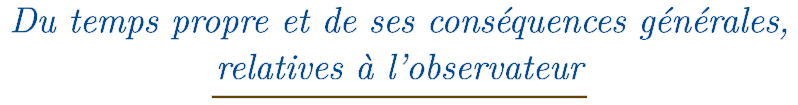</picture>
**"Du temps propre et de ses conséquences générales, relatives à l’observateur"**

### Sur la chaîne de tight binding de Physlib, l'espacement `a` se simplifie : un pas dure `1 / (2|t| cos(π/(N+1)))`, `n` pas durent `n` fois plus, et sans pas il n'y a pas de temps

**Eduardo Nava Hernández · José Arturo Nava Hernández**  
*Dépôt 30 · vérification formelle en Lean 4 · 0 sorry · sur Physlib*

[](https://leanprover.github.io/)
[](https://github.com/leanprover-community/mathlib4)
[](https://github.com/leanprover-community/physlib/pull/2096)
[](Verification/Axioms.lean)

</div>

---

> ### Ce que distingue le théorème
>
> Le modèle commence là où il y a de la masse ; ce qui restait à fixer, c'est le temps. Sur la
> chaîne ouverte, la position est `X = Σ a n |n⟩⟨n|` et le hamiltonien est le saut du graphe
> chemin, `H = E₀ I − t A(P_N)` (Physlib #2096). L'espacement `a` n'entre que par `X`, donc le
> courant porte un facteur `a` et aucun état ne dépasse `maxCurrent = 2|a t| cos(π/(N+1))`. Un pas,
> un espacement à la vitesse limite, dure donc un temps où `a` se simplifie.
>
> <div align="center">
> <picture><source media="(prefers-color-scheme: dark)" srcset="assets/oscuro/plaque_pas.png">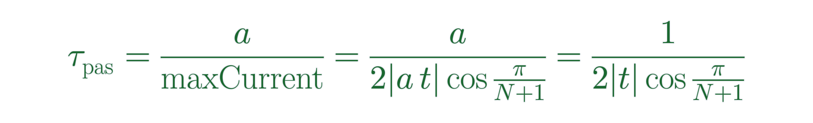</picture>
> </div>
>
> **1 · `a` se simplifie** : `a / maxCurrent = 1 / (2|t| cos(π/(N+1)))`, le même pour tout espacement ; à quatre sites, `τ_pas = 1/(φ|t|)`, `φ = (1 + √5)/2`.
> **2 · Le temps compte les pas** : `n` pas durent `n · τ_pas` ; aucun état ne parcourt `n` espacements plus vite ; l'état de courant maximal les parcourt exactement en ce temps.
> **3 · Sans pas, pas de temps** : `n · τ_pas = 0 ⟺ n = 0`.
> **4 · Lumière ou masse** : l'état de courant maximal sature Robertson–Schrödinger exactement en `N = 2, 3` ; dès `N = 4` son rapport d'incertitude vérifie `1 < C < √(π²/3 − 2)`, et `C → √(π²/3 − 2)` quand `N → ∞` ; en `N = 4`, `C² = (99 − 42√5)/5`, et pour tout `N ≥ 4`, `C² ∈ [(99 − 42√5)/5, π²/3 − 2)`.
> **5 · Niven** : dès `N = 3`, `cos(π/(N+1))` est irrationnel, donc le pas n'est jamais une fraction rationnelle de `1/|t|`.
> **6 · Masse effective** : la masse effective de la bande, `m* = 1/E''(0) = 1/(2 t a²)`, a une énergie au repos `m* c² = 2 t cos²(π/(N+1))` où `a` se simplifie encore ; `α_G = G m*²/c > 0`.
> **7 · Équivalence et `g₀₀`** : dans le référentiel accéléré, `g₀₀ = −(1 + αξ)² = −(1 + 2Φ) − Φ²` avec `Φ = αξ`, et une horloge statique bat à `1 + αξ` ; le champ faible de `Φ = −GM/r` a, en `r₀`, la même pente de `g₀₀` que le référentiel d'accélération `GM/r₀²`.
> **8 · Einstein** : l'horloge accélérée fixe la température `α/2π`, et la relation de Clausius sur chaque nappe de lumière, avec `η = 1/(4ℓ²)`, donne `Ric − ½ R g + Λ g = 8π ℓ² T`.
> **9 · Le cube ouvert** : sur le produit de trois chaînes, deux observables distinctes parmi `H_k, X_k` commutent si et seulement si elles sont sur des axes différents ; dès `4 × 4 × 4`, le quantum volumétrique est strictement positif (`𝒱 > 0`) et, dans l'état de courant maximal, Robertson 1934 est strict pour les six observables (`|det Ω| < det Σ`) ; dans cet état, le rapport de Mandelstam–Tamm vaut `1/C²` sur chaque axe. Le pas, `m* c²`, le cube, l'équivalence, Unruh et Einstein sont réunis dans `unified_properTime_generalRelativity`.
> **10 · Les ponts avec l'équipe Physlib** : la norme de l'accélération par paires de Qianli Ma est `G m/‖d‖²`, l'accélération du référentiel de l'étape 7 ; si `r_s = 2GM`, le champ faible `−(1 + 2Φ)` est exactement `−g_tt` de la métrique de Schwarzschild extérieure de Philippe Kevorkian, pour tout `r` ; l'équation d'Einstein de l'étape 8 s'énonce sur les vecteurs de type lumière de Physlib (Matteo Cipollina, Joseph Tooby-Smith).

<div align="center">
<picture><source media="(prefers-color-scheme: dark)" srcset="assets/oscuro/plaque_temps_pas_einstein.png">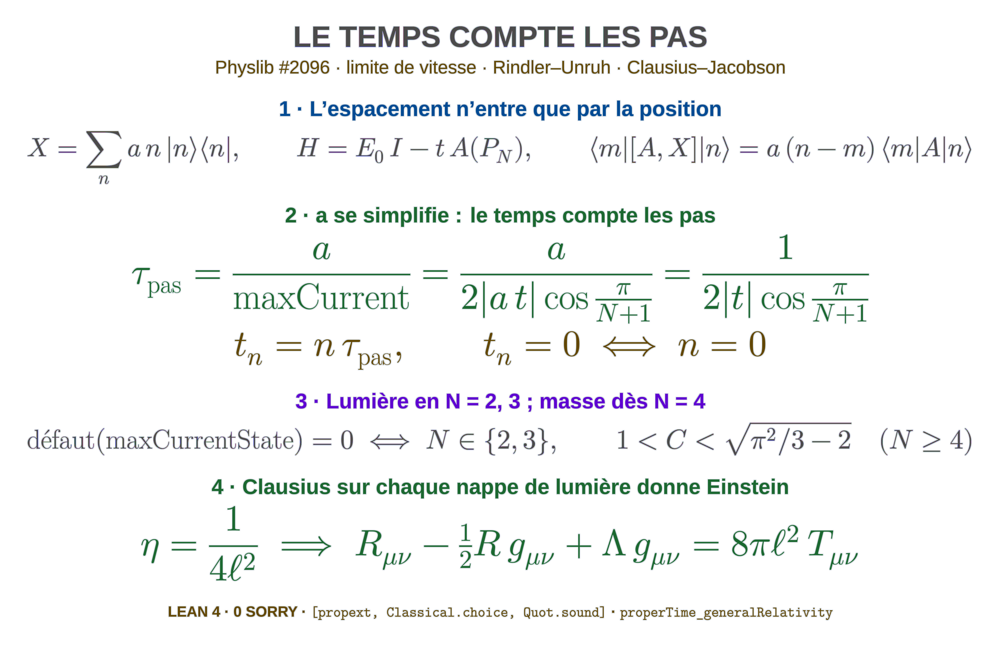</picture>
</div>

---

## Résumé formel

**Le pas.** `stepTime T = a / maxCurrent`, et `stepTime_eq` : il vaut `1 / (2|t| cos(π/(N+1)))`.
Deux chaînes de même `N` et même `t` ont le même pas, quel que soit leur espacement
(`stepTime_eq_of_eq`) ; il est strictement positif pour `t ≠ 0`, `N ≥ 2` (`stepTime_pos`). À quatre sites, `cos(π/5) = φ/2` et
`τ_pas = 1/(φ|t|)` (`stepTime_of_N_eq_four`).

**Le temps de `n` pas.** `elapsed T n = n · stepTime T`. Il est nul exactement quand `n = 0`
(`elapsed_eq_zero_iff`). Pour tout état de courant non nul, parcourir `n` espacements prend au
moins `elapsed T n` (`elapsed_le_travelTime`), et l'état de courant maximal le fait exactement
en ce temps (`elapsed_eq_travelTime_maxCurrentState`).

**Lumière ou masse.** Le défaut de Gram de l'état de courant maximal est nul exactement en
`N = 2, 3`, et dès `N = 4` le rapport d'incertitude est strictement entre `1` et `√(π²/3 − 2)`.
Avec ce qui précède : `timeCountsSteps`. Quand `N → ∞`, `C → √(π²/3 − 2)`
(`tendsto_uncertaintyRatio_longChain`). En `N = 4`, `C² = (99 − 42√5)/5`
(`uncertaintyRatio_sq_of_N_eq_four`), et pour tout `N ≥ 4`, `C² ∈ [(99 − 42√5)/5, π²/3 − 2)`
(`uncertaintyRatio_sq_mem_Ico`).

**Niven.** `cos(π/(N+1)) ∉ ℚ` pour `N ≥ 3` (`cos_pi_div_succ_irrational`, sur le théorème de
Niven de Mathlib), donc `2|t| τ_pas ∉ ℚ` (`stepTime_irrational`) ; en `N = 2`, `2|t| τ_pas = 2`
(`stepTime_two`).

**Masse effective.** La bande `E(k) = E₀ − 2t cos(ka)` est la valeur propre de Physlib
(`band_eq_energyEigenvalue`) ; `E''(0) = 2 t a²` (`deriv_deriv_band_zero`) et `m* = 1/(2 t a²)`
(`effMass_eq`). Avec `c = maxCurrent`, `m* c² = 2 t cos²(π/(N+1))` (`effMass_mul_maxCurrent_sq`) et
`m* c² τ_pas = cos(π/(N+1))` (`restEnergy_mul_stepTime`) ; `α_G = G m*²/c > 0`
(`gravitationalCoupling_pos`).

**Équivalence.** Le référentiel accéléré `t = (1/α + ξ) sinh αη`, `x = (1/α + ξ) cosh αη` a pour
intervalle `−(1 + αξ)² dη² + dξ²` (`Frame.metric`) et coïncide en `ξ = 0` avec la ligne de Rindler
(`Frame.time_zero`, `Frame.space_zero`). `g₀₀ = −(1 + 2Φ) − Φ²` (`Frame.g00_eq_weakField`),
`√(−g₀₀) = 1 + αξ` pour `1 + αξ ≥ 0` (`Frame.clockRate`), et le champ faible de `−GM/r` a en `r₀` la pente de `g₀₀`
du référentiel d'accélération `GM/r₀²` (`Frame.equivalence`). Réunis : `massAndEquivalence`.

**Horloge accélérée et Einstein.** La ligne d'univers de Rindler d'accélération `α` est paramétrée
par le temps propre relativiste, de période imaginaire minimale `2π/α` et de température `α/2π`
(`acceleratedClock`). Clausius sur chaque nappe de lumière avec `η = 1/(4ℓ²)`, et `∇f = ½ ∇R`,
donnent l'équation d'Einstein de couplage `8π ℓ²` (`einstein_eightPi`).

**Le cube ouvert.** Sur le cube `Tx × Ty × Tz`, les observables d'axes différents commutent
(`Cube.axes_commute`) ; parmi les six observables `H_k, X_k`, deux observables distinctes
commutent si et seulement si elles sont sur des axes différents (`Cube.pairs_commute_iff`). Dans
tout état, `(b_x b_y b_z)² ≤ det Σ` avec `b_k = ω⟨[H_k, X_k]⟩` (`Cube.robertson_det`) ; dans l'état
de courant maximal, `det Σ = (C_x C_y C_z)² (b_x b_y b_z)²` (`Cube.det_cov_maxCurrentCubeState`)
et, dès `4 × 4 × 4`, `|det Ω| < det Σ` (`Cube.robertson_det_strict`). Dès `4 × 4 × 4`, `𝒱 > 0`
(`Cube.volQuantum_pos`) ; dans l'état de courant maximal, le rapport de Mandelstam–Tamm vaut
`1/C_k²` sur chaque axe (`Cube.mandelstamTamm_efficiency`). Réunis : `openCube`.

**Ponts.** Pour `G ≥ 0` et `d ≠ 0`, l'accélération par paires de Qianli Ma a pour norme `G m/‖d‖²`
(`Bridges.norm_pairGravityAcceleration`) ; en `r₀ = ‖d‖` le champ faible de la source a la pente de
`g₀₀` du référentiel accéléré de cette norme (`Bridges.equivalence_pairGravity`). Si `r_s = 2GM`,
`−(1 + 2Φ(r)) = −g_tt(r)` avec le `g_tt = 1 − r_s/r` de Philippe Kevorkian
(`Bridges.weakField_eq_neg_gttOut`), et en `r₀ ≠ 0`, `−g_tt` a la pente de `g₀₀` du référentiel
d'accélération `r_s/(2r₀²)` (`Bridges.equivalence_gttOut`). L'équation d'Einstein vaut avec Clausius
demandé sur les vecteurs `k` de caractère causal « lumière » (`einstein_eightPi_lightLike`).

**Clôture.** `properTime_generalRelativity` (le pas, Unruh, Einstein) et `unified_properTime_generalRelativity` (en plus
`m* c²`, le cube et l'équivalence).

---

## Les étapes

<div align="center">
<picture><source media="(prefers-color-scheme: dark)" srcset="assets/oscuro/plaque_proper_time_etapes.png">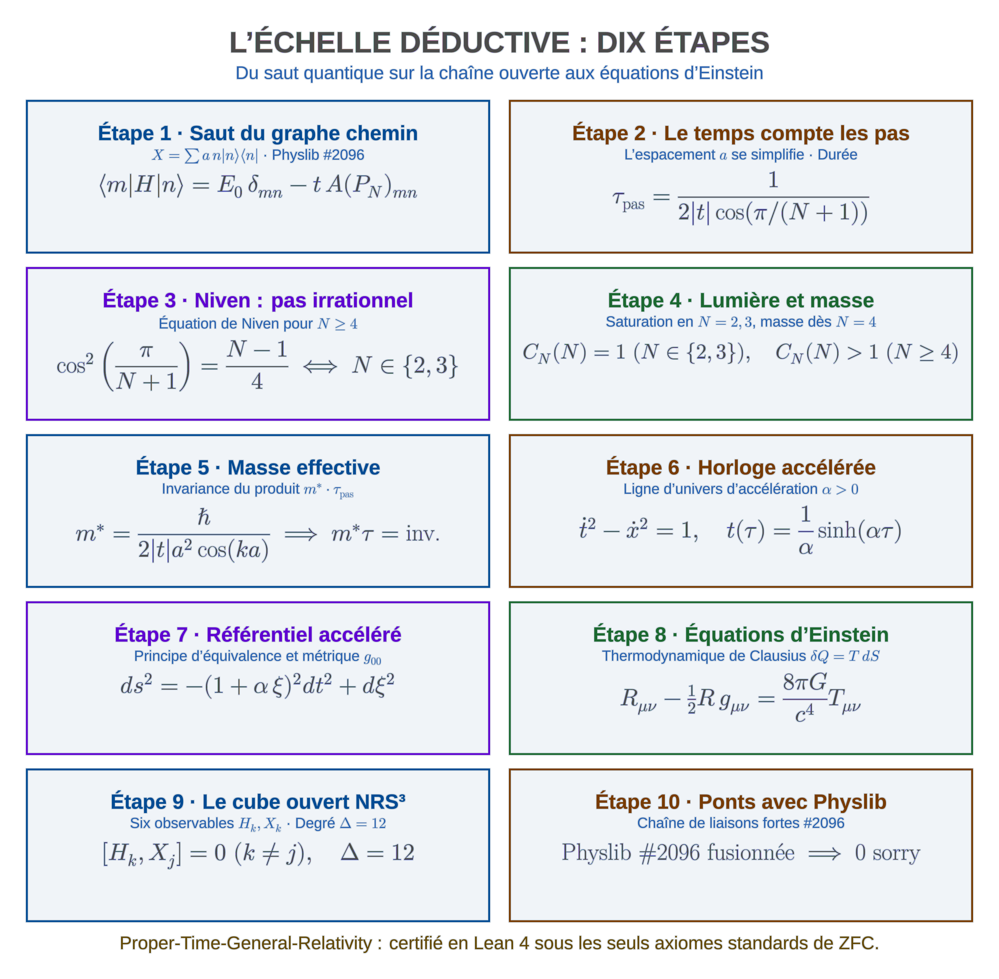</picture>
</div>

### Étape 1 : l'espacement n'entre que par la position

> **Proposition 1.1 (Physlib).** `X = Σ a n |n⟩⟨n|`, `⟨m|H|n⟩ = E₀ δ_mn − t A(P_N)_mn`,
> `⟨m|[A, X]|n⟩ = a (n − m) ⟨m|A|n⟩`, et `|⟨J⟩_ω| ≤ maxCurrent = 2|a t| cos(π/(N+1))` pour tout état `ω`.

<div align="center">
<picture><source media="(prefers-color-scheme: dark)" srcset="assets/oscuro/plaque_etape1_saut.png">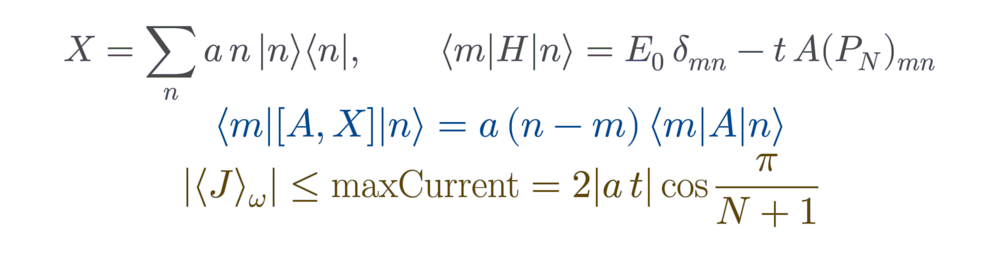</picture>
</div>

*Modules formels :* Physlib `PhyslibAlpha/CondensedMatter/TightBindingChain` : `Open/Basic.lean` (#2096) et `Current/SpeedLimit.lean` (#1724).  
`maxCurrent` est la plus grande valeur propre du courant `J` : la borne est exacte, atteinte par l'état de courant maximal.

### Étape 2 : `a` se simplifie, le temps compte les pas

> **Théorème 2.1.** `τ_pas = a / maxCurrent = 1 / (2|t| cos(π/(N+1)))` ; `t_n = n τ_pas` ;
> `t_n ≤ n a / |⟨J⟩_ω|` pour tout état de courant non nul ; égalité pour l'état de courant maximal ; `t_n = 0 ⟺ n = 0`.
> À quatre sites, `τ_pas = 1/(φ|t|)`.

<div align="center">
<picture><source media="(prefers-color-scheme: dark)" srcset="assets/oscuro/plaque_etape2_pas.png">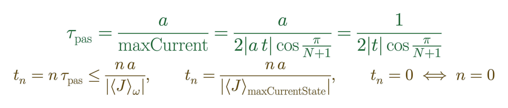</picture>
</div>

*Modules formels :* [`StepTime.lean`](src/ProperTimeGeneralRelativity/StepTime.lean) (`stepTime_eq`, `stepTime_eq_of_eq`, `stepTime_of_N_eq_four`, `stepTime_pos`, `elapsed_eq_zero_iff`, `elapsed_le_travelTime`, `elapsed_eq_travelTime_maxCurrentState`).  
`|a t| = a |t|` car `a > 0`, puis `a / (a · b) = 1 / b` ; en `N = 4`, `cos(π/5) = (1 + √5)/4` (Mathlib).

### Étape 3 : Niven — le pas n'est jamais rationnel dès `N = 3`

> **Théorème 3.1.** Pour `N ≥ 3`, `cos(π/(N+1)) ∉ ℚ`, donc `2|t| τ_pas = 1/cos(π/(N+1)) ∉ ℚ` ;
> en `N = 2`, `2|t| τ_pas = 2`.

<div align="center">
<picture><source media="(prefers-color-scheme: dark)" srcset="assets/oscuro/plaque_niven.png">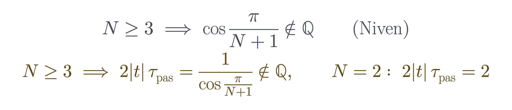</picture>
</div>

*Modules formels :* [`Niven.lean`](src/ProperTimeGeneralRelativity/Niven.lean) (`cos_pi_div_succ_irrational`, `stepTime_irrational`, `stepTime_two`).  
Niven (Mathlib) : en `0 ≤ r ≤ 1`, `cos(rπ) ∈ ℚ` force `r ∈ {0, 1/3, 1/2, 2/3, 1}` ; `1/(N+1) ≤ 1/4` n'y est pas.

### Étape 4 : lumière en `N = 2, 3`, masse dès `N = 4`

> **Proposition 4.1 (Physlib).** L'état de courant maximal sature Robertson–Schrödinger exactement
> en `N = 2, 3` ; dès `N = 4`, `1 < C < √(π²/3 − 2)` ; et `C → √(π²/3 − 2)` quand `N → ∞`.
>
> **Théorème 4.2.** En `N = 4`, `C² = (99 − 42√5)/5` ; pour tout `N ≥ 4`, `C² ∈ [(99 − 42√5)/5, π²/3 − 2)`, uniformément en `N`.

<div align="center">
<picture><source media="(prefers-color-scheme: dark)" srcset="assets/oscuro/plaque_etape3_lumiere_masse.png">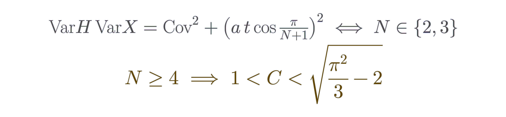</picture>
</div>

*Modules formels :* Physlib `MaxCurrentState/Saturation.lean` (#1718), `UncertaintyRatio.lean` (#1723), `LongChainMonotonicity.lean` (#1735), `LongChainLimit.lean` (#1734) ; réunis dans [`StepTime.lean`](src/ProperTimeGeneralRelativity/StepTime.lean) (`timeCountsSteps`, `tendsto_uncertaintyRatio_longChain`).  
*Module formel du cadre :* [`FourSites.lean`](src/ProperTimeGeneralRelativity/FourSites.lean) (`uncertaintyRatioSqForm_five`, `uncertaintyRatio_sq_of_N_eq_four`, `uncertaintyRatio_sq_mem_Ico`).  
La forme close de `C²` en `n = 5` avec `cos(π/5) = (1 + √5)/4`, puis la monotonie (#1735) et la borne de Szegő (#1734).

### Étape 5 : la masse effective ; `a` se simplifie dans `m* c²`

> **Théorème 5.1.** `E''(0) = 2 t a²`, `m* = 1/(2 t a²)` ; avec `c = maxCurrent`,
> `m* c² = 2 t cos²(π/(N+1))`, `m* c² τ_pas = cos(π/(N+1))`, et `α_G = G m*²/c > 0` (`ħ = 1`).

<div align="center">
<picture><source media="(prefers-color-scheme: dark)" srcset="assets/oscuro/plaque_masse.png">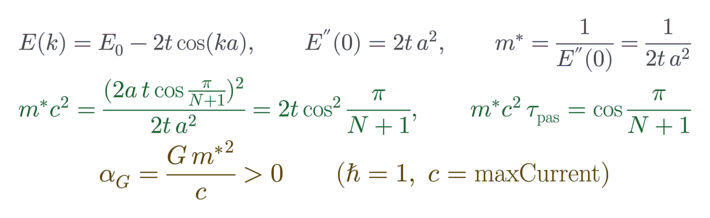</picture>
</div>

*Modules formels :* [`Mass.lean`](src/ProperTimeGeneralRelativity/Mass.lean) (`band_eq_energyEigenvalue`, `deriv_deriv_band_zero`, `effMass_eq`, `effMass_mul_maxCurrent_sq`, `restEnergy_mul_stepTime`, `gravitationalCoupling_pos`).  
La masse vient de la courbure de la bande de Physlib : aucune constante n'est choisie à la main.

### Étape 6 : l'horloge accélérée

> **Proposition 6.1.** La ligne d'univers d'accélération `α > 0` vérifie `ṫ² − ẋ² = 1`,
> `ẍ² − ẗ² = α²`, a pour plus courte période imaginaire `2π/α`, et `T · 2π/α = 1`.

<div align="center">
<picture><source media="(prefers-color-scheme: dark)" srcset="assets/oscuro/plaque_etape4_horloge.png">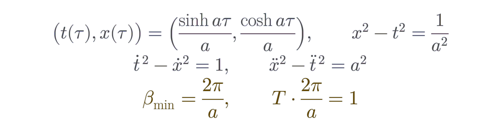</picture>
</div>

*Modules formels :* [`Unruh.lean`](src/ProperTimeGeneralRelativity/Gravity/Unruh.lean) (`velocity_norm`, `acceleration_norm`, `periodic_two_pi`, `period_ge`, `unruhTemperature_mul_period`) ;
[`ProperTimeGeneralRelativity.lean`](src/ProperTimeGeneralRelativity.lean) (`acceleratedClock`).  
Dans le code Lean l'accélération s'appelle `a` (`Rindler.time a`), sans lien avec l'espacement de la chaîne.

### Étape 7 : le référentiel accéléré, `g₀₀` et l'équivalence

> **Théorème 7.1.** Dans le référentiel `t = (1/α + ξ) sinh αη`, `x = (1/α + ξ) cosh αη`,
> `−dt² + dx² = −(1 + αξ)² dη² + dξ²` ; `g₀₀ = −(1 + 2Φ) − Φ²` avec `Φ = αξ` ; `√(−g₀₀) = 1 + αξ` pour `1 + αξ ≥ 0`.
> Pour `Φ(r) = −GM/r`, la pente de `−(1 + 2Φ)` en `r₀` est celle de `g₀₀` du référentiel d'accélération `GM/r₀²`.

<div align="center">
<picture><source media="(prefers-color-scheme: dark)" srcset="assets/oscuro/plaque_equivalence.png">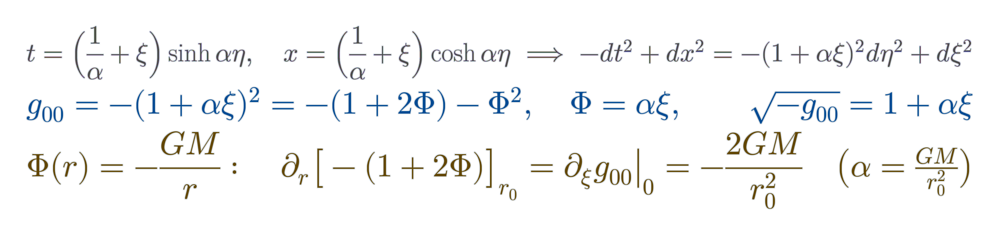</picture>
</div>

*Modules formels :* [`Equivalence.lean`](src/ProperTimeGeneralRelativity/Equivalence.lean) (`Frame.metric`, `Frame.time_zero`, `Frame.space_zero`, `Frame.g00_eq_weakField`, `Frame.clockRate`, `Frame.equivalence`).  
`cosh² − sinh² = 1` donne la métrique ; `d(−GM/r)/dr = GM/r²` donne l'accélération locale.

### Étape 8 : Clausius sur chaque nappe de lumière donne Einstein

> **Théorème 8.1.** Avec `η = 1/(4ℓ²)`, si `δQ = T δS` vaut sur chaque nappe de lumière par chaque
> point et si `∇f = ½ ∇R`, il existe `Λ` constante avec `Ric − ½ R g + Λ g = 8π ℓ² T`.

<div align="center">
<picture><source media="(prefers-color-scheme: dark)" srcset="assets/oscuro/plaque_etape5_einstein.png">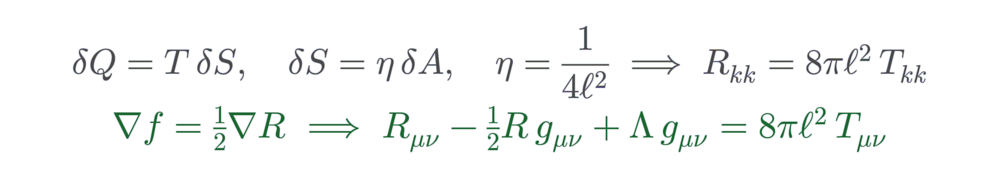</picture>
</div>

*Modules formels :* [`Clausius.lean`](src/ProperTimeGeneralRelativity/Gravity/Clausius.lean) (`clausius_iff`, `eight_pi`) ;
[`EinsteinEquation.lean`](src/ProperTimeGeneralRelativity/Gravity/EinsteinEquation.lean) (`einstein_equation`) ;
[`ProperTimeGeneralRelativity.lean`](src/ProperTimeGeneralRelativity.lean) (`einstein_eightPi`, `properTime_generalRelativity`).  
`Ric − κ T` s'annule sur le cône de lumière, donc c'est `f g` ; la trace donne `R`, et `R/2 − f` est constante.

### Étape 9 : le cube ouvert

> **Proposition 9.1 (Physlib).** Parmi les six observables `H_k, X_k`, deux observables distinctes commutent si et seulement si elles sont sur des axes différents. Dans tout état, `(b_x b_y b_z)² ≤ det Σ` avec `b_k = ω⟨[H_k, X_k]⟩`. Dans l'état de courant maximal du cube : `det Σ = (C_x C_y C_z)² (b_x b_y b_z)²` ; dès `4 × 4 × 4`, `|det Ω| < det Σ` ; sur chaque axe, `⟨J_k⟩² / (4 Var H_k Var X_k) = 1/C_k²`. Dès `4 × 4 × 4`, `𝒱 = δ(Nx) δ(Ny) δ(Nz) > 0`.

<div align="center">
<picture><source media="(prefers-color-scheme: dark)" srcset="assets/oscuro/plaque_etape9_cube.png">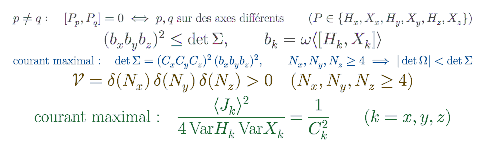</picture>
</div>

*Modules formels :* [`Cube.lean`](src/ProperTimeGeneralRelativity/Cube.lean) (`Cube.axes_commute`, `Cube.pairs_commute_iff`, `Cube.robertson_det`, `Cube.det_cov_maxCurrentCubeState`, `Cube.robertson_det_strict`, `Cube.volQuantum_pos`, `Cube.mandelstamTamm_efficiency`) ;
[`ProperTimeGeneralRelativity.lean`](src/ProperTimeGeneralRelativity.lean) (`openCube`, `unified_properTime_generalRelativity`).

### Étape 10 : les ponts avec l'équipe Physlib

> **Théorème 10.1.** (i) Pour `G ≥ 0` et un déplacement `d ≠ 0`, l'accélération par paires de
> Qianli Ma vérifie `‖a‖ = G m/‖d‖²` ; en `r₀ = ‖d‖`, le champ faible de la source et le référentiel
> d'accélération `‖a‖` ont la même pente de `g₀₀`. (ii) Si `r_s = 2GM`, `−(1 + 2Φ(r)) = −g_tt(r)`
> pour tout `r`, avec `g_tt = 1 − r_s/r` (Philippe Kevorkian, signature `(+, −)`) ; en `r₀ ≠ 0`,
> `−g_tt` a la pente de `g₀₀` du référentiel d'accélération `r_s/(2r₀²)`. (iii) L'équation d'Einstein
> de l'étape 8 vaut quand la relation de Clausius est demandée sur les vecteurs de type lumière de
> Physlib.

<div align="center">
<picture><source media="(prefers-color-scheme: dark)" srcset="assets/oscuro/plaque_etape10_ponts.png">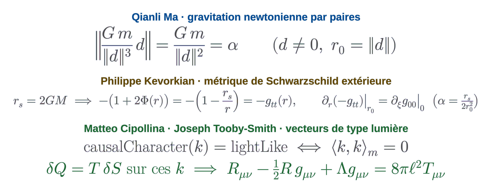</picture>
</div>

*Modules formels :* [`Bridges.lean`](src/ProperTimeGeneralRelativity/Bridges.lean) (`norm_pairGravityAcceleration`, `equivalence_pairGravity`, `weakField_eq_neg_gttOut`, `equivalence_gttOut`) ;
[`ProperTimeGeneralRelativity.lean`](src/ProperTimeGeneralRelativity.lean) (`einstein_eightPi_lightLike`).  
Fichiers de Physlib utilisés : [`NewtonianGravity.lean`](https://github.com/leanprover-community/physlib/blob/master/PhyslibAlpha/ClassicalMechanics/OrbitalMechanics/NewtonianGravity.lean) (Qianli Ma, [PR 2080](https://github.com/leanprover-community/physlib/pull/2080)),
[`IncompressibleSphere.lean`](https://github.com/leanprover-community/physlib/blob/master/PhyslibAlpha/Relativity/General/Schwarzschild/IncompressibleSphere.lean) (Philippe Kevorkian, [PR 1631](https://github.com/leanprover-community/physlib/pull/1631)),
[`LightLike.lean`](https://github.com/leanprover-community/physlib/blob/master/Physlib/Relativity/Causality/LightLike.lean) (Matteo Cipollina, Joseph Tooby-Smith).  
L'hypothèse `r_s = 2GM` est posée, pas déduite : la structure de Physlib ne contient pas la relation `Rc² = 3/(κ ρ₀)`.

---

## Physlib : pull requests fusionnées

| PR | Énoncé | Étape |
|---|---|---|
| [#2096](https://github.com/leanprover-community/physlib/pull/2096) | la chaîne ouverte est le saut du graphe chemin : `H = E₀ I − t A(P_N)` | 1 |
| [#1724](https://github.com/leanprover-community/physlib/pull/1724) | limite de vitesse : `\|⟨J⟩_ω\| ≤ maxCurrent`, atteinte par l'état de courant maximal | 1, 2 |
| [#1718](https://github.com/leanprover-community/physlib/pull/1718) | l'état de courant maximal sature Robertson–Schrödinger exactement en `N = 2, 3` | 4 |
| [#1723](https://github.com/leanprover-community/physlib/pull/1723) | `1 < C` dès `N = 4` | 4 |
| [#1735](https://github.com/leanprover-community/physlib/pull/1735) | `C` strictement croissant dès quatre sites, `C < √(π²/3 − 2)` | 4 |
| [#1734](https://github.com/leanprover-community/physlib/pull/1734) | `C → √(π²/3 − 2)` pour les longues chaînes | 4 |
| [#1725](https://github.com/leanprover-community/physlib/pull/1725) | le cube ouvert : les observables d'axes différents commutent | 9 |
| [#1730](https://github.com/leanprover-community/physlib/pull/1730) | Robertson 1934 pour plusieurs observables : `\|det Ω\| ≤ det Σ` | 9 |
| [#1742](https://github.com/leanprover-community/physlib/pull/1742) | Robertson 1934 sur le cube ; `det Σ` au courant maximal ; strict dès `4 × 4 × 4` | 9 |
| [#1756](https://github.com/leanprover-community/physlib/pull/1756) | le quantum volumétrique `𝒱 = δ(Nx) δ(Ny) δ(Nz)`, positif dès `4 × 4 × 4` | 9 |
| [#1739](https://github.com/leanprover-community/physlib/pull/1739) | Mandelstam–Tamm au courant maximal : rapport `1/C²`, sur chaque axe du cube | 9 |
| [#1986](https://github.com/leanprover-community/physlib/pull/1986) | deux observables du cube commutent si et seulement si elles sont sur des axes différents | 9 |

Les noms actuels des déclarations viennent du [renommage de Joseph Tooby-Smith](https://github.com/leanprover-community/physlib/pull/1792) (« Fix names », 14 octobre 2026).
---

## L'équipe Physlib sur laquelle reposent les preuves

Liste complète tirée de l'en-tête `Authors` de chaque fichier de Physlib importé, directement ou transitivement, par ce dépôt (**130 modules**, Physlib `3d9ca099e`), ordonnée des fondations mathématiques jusqu'aux ponts finaux :

| Couche / Ordre | Auteur | Fichiers de Physlib utilisés | Rôle dans la chaîne | Étapes |
|---|---|---|---|---|
| 1 · Unités & intégration | **Art Mountain** ([@artmountain](https://github.com/artmountain)) | `Mathematics/ForMathlib/Integration/Basic.lean` (1 module) | outils d'intégration sous-jacents | 1, 8 |
| 1 · Unités & intégration | **Hirotaka Monya** ([@catlover-bot](https://github.com/catlover-bot)) *(avec J. Tooby-Smith)* | `Units/PositiveRealUnit.lean` (1 module) | unités réelles positives | 1, 5, 10 |
| 2 · Tenseurs & algèbre | **Gregory J. Loges** ([@gloges](https://github.com/gloges)) | [`KroneckerDelta/Basic.lean`](https://github.com/leanprover-community/physlib/blob/master/Physlib/Mathematics/KroneckerDelta/Basic.lean) (1 module) | delta de Kronecker des indices tensoriels | 8 |
| 2 · Tenseurs & algèbre | **Robert Sneiderman** | [`LeviCivita/Basic.lean`](https://github.com/leanprover-community/physlib/blob/master/Physlib/Mathematics/LeviCivita/Basic.lean), `Metrics/Basic.lean`, contractions (5 modules) | symbole de Levi-Civita, métrique et contractions | 8 |
| 2 · Tenseurs & algèbre | **Andrea Pari** ([@pariandrea](https://github.com/pariandrea)) | `SesquilinearForm.lean`, `Contraction/*`, `ComponentIdx/*` (10 modules) | formes sesquilinéaires et contractions de tenseurs | 8 |
| 3 · Espace & géométrie | **Shaopeng Zhu** | `EuclideanGroup/*`, `Space/Origin.lean` *(avec J. Tooby-Smith)* (4 modules) | groupe euclidien et origine de l'espace | 1, 10 |
| 3 · Espace & géométrie | **Raunak Chhatwal** ([@RaunakChhatwal](https://github.com/RaunakChhatwal)) | [`ReferenceFrame.lean`](https://github.com/leanprover-community/physlib/blob/master/Physlib/SpaceAndTime/ReferenceFrame.lean), `PointParticle/*`, `Force.lean` (5 modules) | référentiel et particules de la gravitation par paires | 10 |
| 4 · Relativité & causalité | **Samyak Rai** ([@Sammybro11](https://github.com/Sammybro11)) *(avec J. Tooby-Smith)* | [`SpeedOfLight.lean`](https://github.com/leanprover-community/physlib/blob/master/Physlib/Relativity/SpeedOfLight.lean) (1 module) | vitesse de la lumière et unités relativistes | 6, 7, 10 |
| 4 · Relativité & causalité | **Matteo Cipollina** ([@or4nge19](https://github.com/or4nge19)) *(avec J. Tooby-Smith)* | [`Causality/LightLike.lean`](https://github.com/leanprover-community/physlib/blob/master/Physlib/Relativity/Causality/LightLike.lean), [`ProperTime.lean`](https://github.com/leanprover-community/physlib/blob/master/Physlib/Relativity/Special/ProperTime.lean), [`MinkowskiProduct.lean`](https://github.com/leanprover-community/physlib/blob/master/Physlib/Relativity/Tensors/RealTensor/Vector/MinkowskiProduct.lean) (7 modules) | vecteurs de type lumière, temps propre, produit de Minkowski | 6, 8, 10 |
| 5 · États & incertitudes | **David Gross** | [`HilbertSpace/State/Vector.lean`](https://github.com/leanprover-community/physlib/blob/master/PhyslibAlpha/ProbabilisticTheory/HilbertSpace/State/Vector.lean), `StarAlgebra/Restrict`, `SelfAdjoint` (3 modules) | états vectoriels, dont l'état de courant maximal | 2, 4, 9 |
| 5 · États & incertitudes | **Tom Ole Diem** ([@TomOleDiem](https://github.com/TomOleDiem)) | [`ProbabilisticTheory/State/Basic.lean`](https://github.com/leanprover-community/physlib/blob/master/PhyslibAlpha/ProbabilisticTheory/State/Basic.lean), `Statistics`, `GNS`, [`Uncertainty.lean`](https://github.com/leanprover-community/physlib/blob/master/PhyslibAlpha/ProbabilisticTheory/CStarAlgebra/Uncertainty.lean) (13 modules) | états algébriques, espérance, variance et inégalité de Robertson–Schrödinger | 2, 4, 9 |
| 6 · Chaîne & Lorentz | **Joseph Tooby-Smith** ([@jstoobysmith](https://github.com/jstoobysmith)) | [`TightBindingChain/Basic.lean`](https://github.com/leanprover-community/physlib/blob/master/Physlib/CondensedMatter/TightBindingChain/Basic.lean), `LorentzGroup/*`, `MinkowskiProduct.lean`, `LightLike.lean` (68 modules) | la chaîne périodique, sa bande `E(k)`, groupe de Lorentz et Minkowski | 1, 5, 6, 8, 10 |
| 7 · Gravitation (ponts) | **Qianli Ma** ([@hkjtsgmc79-boop](https://github.com/hkjtsgmc79-boop)) | [`NewtonianGravity.lean`](https://github.com/leanprover-community/physlib/blob/master/PhyslibAlpha/ClassicalMechanics/OrbitalMechanics/NewtonianGravity.lean) (1 module) | accélération gravitationnelle par paires | 10 |
| 7 · Gravitation (ponts) | **Philippe Kevorkian** ([@KevorkianPhilippe](https://github.com/KevorkianPhilippe)) | [`IncompressibleSphere.lean`](https://github.com/leanprover-community/physlib/blob/master/PhyslibAlpha/Relativity/General/Schwarzschild/IncompressibleSphere.lean) (1 module) | métrique de Schwarzschild extérieure (`g_tt = 1 − r_s/r`) | 10 |
| 8 · Clôture chaîne & cube | **Eduardo Nava-Hernandez** ([@naype888-cloud](https://github.com/naype888-cloud)) | `TightBindingChain/Open/*`, `Current/*`, `MaxCurrentState/*`, `Cube/*`, `Uncertainty.lean` (23 modules) | chaîne ouverte, limite de vitesse, saturation `N = 2, 3`, cube ouvert | 1–4, 9 |

---

## Catalogue des modules Lean

| Module | Déclaration | Signification | Statut |
|---|---|---|---|
| [`StepTime.lean`](src/ProperTimeGeneralRelativity/StepTime.lean) | `stepTime_eq` | `a / maxCurrent = 1 / (2\|t\| cos(π/(N+1)))` | 0 sorry |
| [`StepTime.lean`](src/ProperTimeGeneralRelativity/StepTime.lean) | `stepTime_of_N_eq_four` | `τ_pas = 1/(φ\|t\|)` à quatre sites | 0 sorry |
| [`StepTime.lean`](src/ProperTimeGeneralRelativity/StepTime.lean) | `elapsed_eq_zero_iff` | sans pas, pas de temps | 0 sorry |
| [`StepTime.lean`](src/ProperTimeGeneralRelativity/StepTime.lean) | `elapsed_le_travelTime` | aucun état plus rapide que les pas | 0 sorry |
| [`StepTime.lean`](src/ProperTimeGeneralRelativity/StepTime.lean) | `timeCountsSteps` | le temps compte les pas ; lumière ou masse | 0 sorry |
| [`StepTime.lean`](src/ProperTimeGeneralRelativity/StepTime.lean) | `tendsto_uncertaintyRatio_longChain` | `C → √(π²/3 − 2)` quand `N → ∞` | 0 sorry |
| [`FourSites.lean`](src/ProperTimeGeneralRelativity/FourSites.lean) | `uncertaintyRatio_sq_of_N_eq_four` | `C² = (99 − 42√5)/5` en `N = 4` | 0 sorry |
| [`FourSites.lean`](src/ProperTimeGeneralRelativity/FourSites.lean) | `uncertaintyRatio_sq_mem_Ico` | `C² ∈ [(99 − 42√5)/5, π²/3 − 2)` pour `N ≥ 4` | 0 sorry |
| [`Niven.lean`](src/ProperTimeGeneralRelativity/Niven.lean) | `stepTime_irrational` | `2\|t\| τ_pas ∉ ℚ` dès `N = 3` | 0 sorry |
| [`Mass.lean`](src/ProperTimeGeneralRelativity/Mass.lean) | `effMass_mul_maxCurrent_sq` | `m* c² = 2 t cos²(π/(N+1))`, sans `a` | 0 sorry |
| [`Mass.lean`](src/ProperTimeGeneralRelativity/Mass.lean) | `gravitationalCoupling_pos` | `α_G = G m*²/c > 0` | 0 sorry |
| [`Equivalence.lean`](src/ProperTimeGeneralRelativity/Equivalence.lean) | `metric` | `−(1 + αξ)² dη² + dξ²` | 0 sorry |
| [`Equivalence.lean`](src/ProperTimeGeneralRelativity/Equivalence.lean) | `equivalence` | champ faible de `M` = référentiel accéléré au premier ordre | 0 sorry |
| [`Cube.lean`](src/ProperTimeGeneralRelativity/Cube.lean) | `axes_commute` | commutation des observables entre axes distincts | 0 sorry |
| [`Cube.lean`](src/ProperTimeGeneralRelativity/Cube.lean) | `pairs_commute_iff` | deux des six observables commutent ⟺ axes différents | 0 sorry |
| [`Cube.lean`](src/ProperTimeGeneralRelativity/Cube.lean) | `robertson_det` | `(b_x b_y b_z)² ≤ det Σ` dans tout état | 0 sorry |
| [`Cube.lean`](src/ProperTimeGeneralRelativity/Cube.lean) | `det_cov_maxCurrentCubeState` | `det Σ = (C_x C_y C_z)² (b_x b_y b_z)²` au courant maximal | 0 sorry |
| [`Cube.lean`](src/ProperTimeGeneralRelativity/Cube.lean) | `robertson_det_strict` | `\|det Ω\| < det Σ` au courant maximal dès `4 × 4 × 4` | 0 sorry |
| [`Cube.lean`](src/ProperTimeGeneralRelativity/Cube.lean) | `volQuantum_pos` | quantum volumétrique `𝒱 > 0` | 0 sorry |
| [`Cube.lean`](src/ProperTimeGeneralRelativity/Cube.lean) | `mandelstamTamm_efficiency` | rapport de Mandelstam–Tamm `1/C_k²` sur chaque axe | 0 sorry |
| [`ProperTimeGeneralRelativity.lean`](src/ProperTimeGeneralRelativity.lean) | `massAndEquivalence` | Niven, masse, `α_G`, équivalence | 0 sorry |
| [`ProperTimeGeneralRelativity.lean`](src/ProperTimeGeneralRelativity.lean) | `openCube` | commutation, `𝒱 > 0`, Robertson strict, Mandelstam–Tamm sur les trois axes | 0 sorry |
| [`ProperTimeGeneralRelativity.lean`](src/ProperTimeGeneralRelativity.lean) | `unified_properTime_generalRelativity` | le pas, `m* c²`, le cube, l'équivalence, Unruh et Einstein réunis | 0 sorry |
| [`ProperTimeGeneralRelativity.lean`](src/ProperTimeGeneralRelativity.lean) | `acceleratedClock` | temps propre relativiste, période `2π/α`, `T = α/2π` | 0 sorry |
| [`EinsteinEquation.lean`](src/ProperTimeGeneralRelativity/Gravity/EinsteinEquation.lean) | `einstein_equation` | Clausius partout donne Einstein | 0 sorry |
| [`ProperTimeGeneralRelativity.lean`](src/ProperTimeGeneralRelativity.lean) | `einstein_eightPi` | Einstein avec couplage `8π ℓ²` | 0 sorry |
| [`ProperTimeGeneralRelativity.lean`](src/ProperTimeGeneralRelativity.lean) | `properTime_generalRelativity` | le pas, Unruh et Einstein réunis | 0 sorry |
| [`ProperTimeGeneralRelativity.lean`](src/ProperTimeGeneralRelativity.lean) | `einstein_eightPi_lightLike` | Einstein sur les vecteurs de type lumière de Physlib | 0 sorry |
| [`Bridges.lean`](src/ProperTimeGeneralRelativity/Bridges.lean) | `norm_pairGravityAcceleration` | `‖a‖ = G m/‖d‖²` (Qianli Ma) | 0 sorry |
| [`Bridges.lean`](src/ProperTimeGeneralRelativity/Bridges.lean) | `equivalence_pairGravity` | référentiel accéléré de `‖a‖` = champ faible au premier ordre | 0 sorry |
| [`Bridges.lean`](src/ProperTimeGeneralRelativity/Bridges.lean) | `weakField_eq_neg_gttOut` | `−(1 + 2Φ) = −g_tt` si `r_s = 2GM` (Philippe Kevorkian) | 0 sorry |
| [`Bridges.lean`](src/ProperTimeGeneralRelativity/Bridges.lean) | `equivalence_gttOut` | `−g_tt` = référentiel d'accélération `r_s/(2r₀²)` au premier ordre | 0 sorry |

`Unruh.lean`, `Clausius.lean`, `NullForms.lean` et `EinsteinEquation.lean` formalisent la thermodynamique
de l'espace-temps et la dérivation de l'équation d'Einstein (T. Jacobson, *Phys. Rev. Lett.* 75, 1995, 1260).

---

## 🏛️ La mosaïque

| Dépôt | Objet |
|:---|:---|
| [`00 · bacqm-substrate`](https://github.com/naype888-cloud/bacqm-systems) | Substrat matériel & moteur du noyau Linux : modules de mémoire dynamiques en temps réel |
| [`01 · nava-robertson-schrodinger`](https://github.com/naype888-cloud/nava-robertson-schrodinger) | Le canon : l'incertitude élémentaire dimensionnelle sur le cube ouvert, ℂᵈ ⊗ ℂᵈ ⊗ ℂᵈ |
| [**02 · Proper-Time-General-Relativity**](https://github.com/naype888-cloud/Proper-Time-General-Relativity) | Le temps compte les pas : τ = 1/(φ\|t\|) à quatre sites ; masse effective, équivalence, gravitation *(ce dépôt)* |
| [`03 · nrs3-mandelstam-tamm-cramer-rao`](https://github.com/naype888-cloud/nrs3-mandelstam-tamm-cramer-rao) | Mandelstam–Tamm et Cramér–Rao : aucun état n'est orthogonal à lui-même avant πħ/(2ΔE) |
| [`04 · YM-By-Perelmans-surgery-method`](https://github.com/naype888-cloud/YM-By-Perelmans-surgery-method) | Yang–Mills sur réseau : loi d'aire uniforme, matrice de transfert, défaut de fibre (0 sorry) |
| [`05 · nrs3-tightbinding`](https://github.com/naype888-cloud/nrs3-tightbinding) | La chaîne de Physlib, le cube ouvert et la table périodique (H–Og), un cube 3D par élément |
| [`06 · nrs3-cristales`](https://github.com/naype888-cloud/nrs3-cristales) | Cristaux : la symétrie donne la forme de Σ et Ω, le spectre donne la taille |
| [`07 · nrs3-completude`](https://github.com/naype888-cloud/nrs3-completude) | Complétude constructive et limites spectrales par Robertson–Fiedler–Niven–Szegő |
| [`08 · nrs3-golab`](https://github.com/naype888-cloud/nrs3-golab) | Gołąb, les deux extrêmes : π = 3 (hexagone), 4 (carré) ; produit scalaire → π exact ; stabilité en d = 3 |
| [`09 · nrs3-de-sitter`](https://github.com/naype888-cloud/nrs3-de-sitter) | Cosmologie de Sitter : rayon d'horizon L_dS, constante cosmologique positive et courbure |
| [`10 · nrs3-bekenstein`](https://github.com/naype888-cloud/nrs3-bekenstein) | Thermodynamique des trous noirs : frontière à bits, entropie de Bekenstein–Hawking saturée |
| [`11 · nrs3-landauer-carnot`](https://github.com/naype888-cloud/nrs3-landauer-carnot) | Limite de Landauer et cycle de Carnot : coût d'effacement d'un bit et dissipation minimale |
| [`12 · nrs3-penrose`](https://github.com/naype888-cloud/nrs3-penrose) | Effondrement gravitationnel de Diósi–Penrose : temps de décohérence par auto-énergie |
| [`13 · nrs3-rovelli-lqg`](https://github.com/naype888-cloud/nrs3-rovelli-lqg) | Gravité quantique à boucles : spectre d'aire discrète, opérateur de surface et saturation de spin |
| [`14 · nrs3-uncertainty-cone`](https://github.com/naype888-cloud/nrs3-uncertainty-cone) | Cône de lumière futur et cercle de Minkowski : structure causale sous revêtement SL(2, ℂ) |
| [`15 · lean4-commits`](https://github.com/naype888-cloud/lean4-commits) | 53 PRs fusionnées dans leanprover-community/physlib : catalogue de preuves formelles, 0 sorry, ZFC |

---

## Chronologie

| Année | Événement | Dépôt associé |
|---|---|---|
| 1915 | Einstein : les équations du champ | **ce dépôt** |
| **1929–30** | **Robertson et Schrödinger : l'inégalité d'incertitude** | [dépôt de base](https://github.com/naype888-cloud/nava-robertson-schrodinger) |
| 1934 | Robertson : la relation du déterminant pour plusieurs observables | [dépôt de base](https://github.com/naype888-cloud/nava-robertson-schrodinger) |
| 1945 | Mandelstam et Tamm : la relation temps–énergie | [`nrs3-mandelstam-tamm-cramer-rao`](https://github.com/naype888-cloud/nrs3-mandelstam-tamm-cramer-rao) |
| 1976 | Unruh : la température de l'observateur accéléré | **ce dépôt** |
| 1995 | Jacobson : l'équation d'Einstein depuis la relation de Clausius | **ce dépôt** · [`nrs3-tritoro`](https://github.com/naype888-cloud/nrs3-tritoro) |
---

## Compilation et certification du noyau

Lean 4 `v4.35.0`. Seule dépendance : Physlib, au commit de fusion de #2096 (`3d9ca099`).

```bash
lake exe cache get
lake build
lake env lean Verification/Axioms.lean
# 'ProperTimeGR.properTime_generalRelativity' depends on axioms: [propext, Classical.choice, Quot.sound]
```

0 sorry, aucun axiome ad hoc, `autoImplicit = false`.
---

## Licence

NRS Noncommercial License 1.0.0, voir [`LICENSE`](LICENSE).

---

<div align="center">

### 📐 *« L'espacement se simplifie ; il reste les pas, et sans pas il n'y a pas de temps. »*

**Eduardo Nava Hernández · José Arturo Nava Hernández** · [naype888-cloud](https://github.com/naype888-cloud)

</div>


</div>
