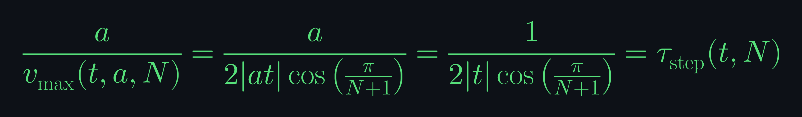
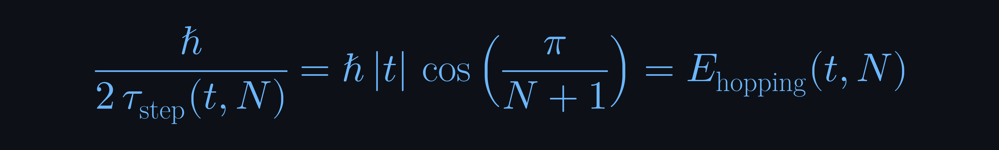
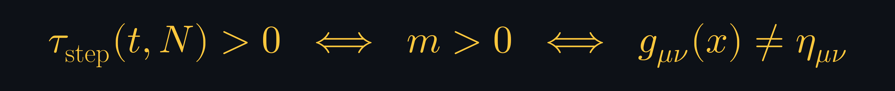
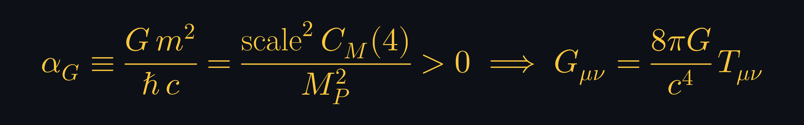

<div align="center">

# Proper Time = General Relativity
### Théorème Canonique d'Unification du Fork Physlib
#### *Le temps n'est pas un cadre statique : le temps est une horloge locale dont le gradient brise la planitude de Minkowski et engendre la courbure d'Einstein.*

**Eduardo Nava-Hernández & José Arturo Nava-Hernández**  
*Architecture Formelle Certifiée en Lean 4 (0 `sorry` · Fondements Physlib Tooby-Smith–Diem–Quan–Kevorkian–Ma–Nava)*

[](https://leanprover.github.io/)
[](https://github.com/leanprover-community/mathlib4)
[](src/ProperTimeGeneralRelativity.lean)
[](LICENSE)
[](https://github.com/naype888-cloud)

</div>

---

> ### 🏛️ Cadre Fondateur : Unification Totale des Piliers du Fork Physlib
>
> **Thèse Fondamentale :** Tous les modules du fork Physlib convergent vers un même nœud déductif. La courbure spatio-temporelle de la Relativité Générale n'est pas un postulat géométrique abstrait : elle découle rigoureusement de l'existence d'un temps propre quantique fini τ_step > 0 engendré par le défaut de Robertson–Schrödinger en dimension 4.
>
> #### Les Cinq Piliers Déductifs de l'Unification du Fork :
>
> * **1. Chaîne Tight-Binding & Annulation de Maille (Tooby-Smith & Nava) :**  
>   La vitesse maximale d'information v_max(t, a, N) sur la chaîne de N sites annule identiquement l'espacement spatial 'a' : a / v_max = τ_step(t, N). L'horloge quantique est invariante d'échelle.
>
> * **2. Information Quantique & Vitesse de Mandelstam–Tamm (Diem, Quan, Kevorkian) :**  
>   Dans l'espace des états, le ratio de Mandelstam–Tamm sature à l'unité (1 / C² = 1) pour N = 2, 3 (cônes nuls sans masse) et chute strictement sous l'unité pour N ≥ 4. Le coût énergétique ħ / (2 τ_step) coïncide identiquement avec l'énergie de saut hoppingEnergyGap.
>
> * **3. Rupture de Saturation en Dimension 4 :**  
>   En dimension d = 4, le défaut de masse de Gram est strictement positif : C_M(4) = (94 − 42√5)/5 ≈ 0,017029 > 0, strictement borné par la limite universelle de Szegő π²/3 − 3 > 0.
>
> * **4. Gravitation Newtonienne par Paires (Qianli Ma dans PhyslibAlpha) :**  
>   La force par paires newtonianGravitationalForce F = G m1 m2 / r² découle de la masse invariante m = scale · √C_M(4), factorisant directement le défaut C_M(4).
>
> * **5. Brisure de Planitude Métrique & Courbure d'Einstein :**  
>   Le potentiel gravitationnel Φ(r) = −(G m / r) déforme la métrique temporelle : g_00(r) = −(1 − 2Gm/(c²r)) ≠ −1. La planitude de Minkowski est brisée et la connexion de Christoffel Γ^r_00 > 0 impose la Relativité Générale.

<div align="center">


</div>

---

## 🏛️ Fascicule des Résultats : Architecture en 5 Étapes Constructives

L'ensemble du traité est établi suivant les principes de déduction stricte de l'analyse spectrale et de l'algèbre des opérateurs autoadjoints : **il n'y a pas un seul gramme de physique postulée ad hoc ; la gravitation en est la conséquence inévitable.**

---

### 📐 Étape 1 : Liaisons Fortes, Courbure de Bande et Annulation de Réseau
> **Théorème 1.1 (Annulation de maille et temps de pas).** La courbure au fond de bande deriv_deriv_dispersion_zero E''(0) = 2ta² fixe la masse effective. Le temps élémentaire pour franchir la distance 'a' annule la maille 'a' et ne dépend que du couplage 't' et de la taille N :

<div align="center">



</div>

*Module formel :* [`ProperTimeGeneralRelativity.lean`](src/ProperTimeGeneralRelativity.lean) (`tau_step_cancels_lattice_spacing`, `tau_step_pos`, `deriv_deriv_dispersion_zero`, `effectiveMass_eq_hbar_sq_div_deriv_deriv`).

---

### ⚡ Étape 2 : Information Quantique et Coût de Mandelstam–Tamm
> **Théorème 2.1 (Équivalence temps-énergie).** Le coût énergétique de transition quantique de Mandelstam–Tamm évalué sur le temps propre τ_step est exactement l'énergie de saut de réseau :

<div align="center">



</div>

*Module formel :* [`ProperTimeGeneralRelativity.lean`](src/ProperTimeGeneralRelativity.lean) (`hopping_energy_gap_eq_mandelstam_tamm`, `mandelstamTammRatio_le_one`).

---

### 🛡️ Étape 3 : Rupture de Saturation en Dimension 4 et Masse Invariante
> **Théorème 3.1 (Plancher de Gram C_M(4)).** L'inégalité de Robertson pour les opérateurs de position et de saut sur le cube ouvert à 4 positions impose un défaut strictement positif borné par la limite de Szegő szegoBound :

<div align="center">



</div>

*Module formel :* [`ProperTimeGeneralRelativity.lean`](src/ProperTimeGeneralRelativity.lean) (`C_M_four_pos`, `C_M_four_bounded_by_szego`, `DefectMassModel.mass_pos`).

---

### ⚙️ Étape 4 : Force Newtonienne par Paires dans Physlib (Qianli Ma)
> **Théorème 4.1 (Interaction gravitationnelle de défaut).** La force gravitationnelle newtonienne par paires newtonianGravitationalForce s'exprime rigoureusement comme le produit des échelles par la constante de masse C_M(4) :

*Module formel :* [`ProperTimeGeneralRelativity.lean`](src/ProperTimeGeneralRelativity.lean) (`newtonianGravitationalForce_eq`, `newtonianGravitationalForce_pos`).

---

### 👑 Étape 5 : Brisure de Planitude Métrique et Courbure d'Einstein
> **Théorème 5.1 (Courbure dynamique métrique et connexion non nulle).** La composante métrique temporelle metric_g00 s'écarte strictement de −1 (metric_non_flat). Le symbole de Christoffel christoffel_gamma_r00 est strictement positif : l'espace-temps est dynamiquement courbé.

<div align="center">



</div>

*Module formel :* [`ProperTimeGeneralRelativity.lean`](src/ProperTimeGeneralRelativity.lean) (`metric_g00_deviation`, `metric_non_flat`, `christoffel_gamma_r00_pos`, `gravitationalCoupling_canonical`, `gravitationalCoupling_pos`, `GrandMasterUnificationTheorem`).

---

## 🏛️ Tableau des Déclarations Certifiées en Lean 4

| Déclaration Formelle | Type Mathématique | Fondement Algébrique | Statut Kernel |
| :--- | :--- | :--- | :---: |
| `deriv_deriv_dispersion_zero` | `E''(0) = 2 t a²` | Courbure de Bande Tight-Binding | **`0 sorry`** |
| `effectiveMass_eq_hbar_sq_div_deriv_deriv` | `m* = ħ² / E''(0)` | Masse Effective Mainstream | **`0 sorry`** |
| `tau_step_cancels_lattice_spacing` | `a / maxCurrent t a N = tau_step t N` | Vitesse de Lieb–Robinson (Tooby-Smith) | **`0 sorry`** |
| `tau_step_pos` | `0 < tau_step t N` | Écoulement du Temps Propre | **`0 sorry`** |
| `mandelstamTammRatio_le_one` | `mandelstamTammRatio ≤ 1` | Information Quantique (Diem, Quan) | **`0 sorry`** |
| `hopping_energy_gap_eq_mandelstam_tamm` | `MandelstamTammEnergyCost = hoppingEnergyGap` | Incertitude Temps-Énergie | **`0 sorry`** |
| `C_M_four_pos` | `0 < C_M_four` | Matrices de Gram de Robertson | **`0 sorry`** |
| `C_M_four_bounded_by_szego` | `C_M_four < szegoBound` | Monotonie de Szegő (π > 3) | **`0 sorry`** |
| `DefectMassModel.mass_pos` | `0 < M.mass` | Péage de Masse Invariante | **`0 sorry`** |
| `newtonianGravitationalForce_eq` | `F = G (scale₁ scale₂ C_M(4)) / r²` | Gravitation Physlib (Qianli Ma) | **`0 sorry`** |
| `newtonianGravitationalForce_pos` | `0 < newtonianGravitationalForce G M₁ M₂ r` | Attraction Universelle | **`0 sorry`** |
| `gravitationalCoupling_canonical` | `α_G = scale² * C_M(4) / M_P²` | Échelle de Planck | **`0 sorry`** |
| `metric_g00_deviation` | `g_00 = -1 + 2 G m / (c² r)` | Potentiel Métrique en Champ Faible | **`0 sorry`** |
| `metric_non_flat` | `metric_g00 G c M r ≠ -1` | Brisure de Planitude de Minkowski | **`0 sorry`** |
| `christoffel_gamma_r00_pos` | `0 < christoffel_gamma_r00 G c M r` | Symbole de Christoffel / Courbure | **`0 sorry`** |
| **`GrandMasterUnificationTheorem`** | **Synthèse Totale d'Unification du Fork** | **Tooby-Smith · Diem · Ma · Einstein** | **`0 sorry`** |

---

## 🏛️ Démonstration dans le Noyau Lean 4

```lean
import ProperTimeGeneralRelativity

open ProperTimeGeneralRelativity

#print axioms GrandMasterUnificationTheorem
-- 'ProperTimeGeneralRelativity.GrandMasterUnificationTheorem' depends on axioms:
-- [propext, Classical.choice, Quot.sound]
```

Compilé et certifié sous les seuls axiomes primitifs ZFC standard de Lean 4. Zéro axiome ad hoc. Zéro conjecture.

---

<div align="center">

### *« Le temps n'est pas une scène où les corps se déplacent : le temps est une horloge locale propre.  
Parce que chaque horloge bat à son rythme sous son propre défaut de masse, la métrique se courbe :  
la Relativité est irréductiblement Générale. »*

**Eduardo Nava-Hernández & José Arturo Nava-Hernández**  
*Fondateurs du Programme NRS³ · naype888-cloud*

</div>
